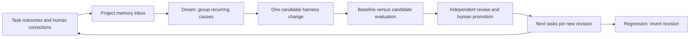

# Project-local adaptive harness: evidence and a proposed learning loop

Research date: 2026-11-13. Status: proposal; no configuration is changed.

## Questions

1. What does the existing memory/dream implementation already do, and what is missing for measured improvement?
2. Can agents safely propose additions, edits and removals to skills, agents, rules and checks based on actual task outcomes?
3. What evidence supports automatic adaptation, and what separates a plausible proposal from an improvement that generalizes?
4. Which changes can run automatically in an experiment, which require human promotion, and how should a project recover from a regression?
5. What is the smallest useful first version that preserves tackroom's project-local, manually copied baseline?

## Findings

The baseline already contains the first half of this idea. `docs/memory-and-dreaming.md`
and `template/.claude/skills/dream/SKILL.md` describe transcript analysis, consolidation,
and proposed workflow changes after two recurrences or one harmful incident. The dream
pass can recommend removing guidance as well as adding it. It does not apply those
proposals automatically. What is missing is measured promotion: linking a proposed
change to outcomes, evaluating it against the old harness, and rolling it back if it
regresses. This is a repository observation, not a newly discovered external practice.

There is direct practitioner evidence for an outer improvement loop. Warp's founder
describes an ordinary task skill, recorded human feedback, and a scheduled agent that
edits that skill through review. Anthropic's later Warp case study adds the recommendation
to build the verification harness first. This is Warp practice reported by Anthropic,
not proof that the Claude Code team uses the identical system. [W1, W2]

The strongest new code reference is **`warpdotdev-demos/issue-triage-loop`**, not the
older `warpdotdev/warp-agents-demo-github-issue-triage` linked in the Anthropic article.
The newer demo has both the task skill and an improver. Its improver reads 14 days of
feedback, attributes decisions to versioned comment markers, limits learned guidance
to 15 bullets, permits doing nothing, and proposes a PR for human merge. It revises or
removes contradictory guidance. These are inspectable instructions, not measured proof
of effectiveness. No demo was executed here. [W3–W5]

There are weaknesses worth avoiding. The demo treats a maintainer relabel as ground
truth and silence as weak positive feedback. **Inference:** a label can change because
new information arrived, and silence can mean nobody reviewed the result. Record the
reason and the information available at decision time; treat silence as unknown.
The demo has no demonstrated held-out outcome evaluation in the inspected skill.
Its prose restrictions are not access controls. [W4, steps 2–4]

Anthropic's existing hillclimbing article recommends train/test separation, measurement
of evaluator noise, one change per round, and rejecting gains confined to training
cases. Its reviewer article also measures harmful false positives on known-clean PRs
and caps repeated review rounds. These are already in our corpus; applying them to
dream proposals is the useful missing connection. [A1, A2]

## Proposed loop (judgment call)

1. **Capture outcomes, not only transcripts.** Each run records the task/spec revision,
   harness commit, memory snapshot, model/version/settings, environment and seed version,
   tests attempted/passed/skipped, review corrections, human minutes, rework, elapsed
   compute, spend, and eventual revert/incident. Store links to evidence, not private
   browser sessions or raw production data. Mark unaudited outcomes as unknown.
2. **Diagnose before editing instructions.** Classify failures as ambiguous scope,
   environment/data, tool interface, missing test, implementation, review noise, stale
   memory, or missing workflow guidance. A broken seed script should become a script fix;
   adding another paragraph to an agent does not repair it.
3. **Generate one small candidate.** Prefer a deterministic check, reusable script, or
   edit/removal in an existing skill. Add a new agent only when a distinct role or fresh
   context demonstrably helps. Each candidate names the incidents, hypothesis, expected
   improvement, cost/latency limit, affected files, and rollback revision. A dream with no
   candidate is a successful outcome. Start weekly or after ten completed tasks; these
   thresholds are pilot choices, not Anthropic recommendations.
4. **Evaluate outside the production loop.** Start with roughly 12–20 representative
   historical tasks, including success cases and known regressions. Split into development
   cases and a held-out set; keep labels and private grading checks out of the optimizer's
   workspace. Replay baseline and candidate with the same tool/data conditions and several
   repetitions for noisy cases. Check successful task completion, regression detection,
   false blockers, human effort, cost and time. Small samples are directional evidence.
   Use a separate final acceptance set or periodically refresh the holdout: repeatedly
   choosing changes against the same test score also overfits.
5. **Promote deliberately.** A fresh reviewer examines both the diff and evidence; a
   human approves the pilot's harness PR. Pin each already-running task to its original
   harness and memory revision. Start the new revision on a few low-risk tasks; retain
   the previous revision for immediate rollback. Compare comparable task classes rather
   than crediting an easier batch of tasks to the new prompt.
6. **Prune and retest.** Store provenance, last confirmation and expiry/review date for
   lessons. Consolidate repeated guidance. Re-evaluate when the model, tools, tests or
   project architecture change. Track instruction size and review rounds so "improvement"
   does not quietly mean more context and more agents.

Automatic proposal generation and sandbox experiments are useful autonomy. Initially,
promotion of agents, rules, skills and workflow behavior still requires human review.
Later, narrowly defined factual memory updates could be automatic with provenance and
rollback. The improver must never grant itself permissions, edit its private evaluator,
weaken accepted tests, change who may approve, or deploy itself. Enforce those boundaries
in protected CI and repository policy, outside the task's writable checkout.

The baseline remains manually copied into each project. Project-specific learning lives
with that project. Good general lessons can be proposed back to tackroom separately;
this proposal does not introduce a registry, synchronization or automatic fleet rollout.

## What to add first

| Existing capability | Missing addition | First useful result |
|---|---|---|
| Transcript memory and dream proposals | Outcome record with harness revision | Know which setup produced a failure |
| Human corrections in GitHub | Feedback collector with actor/provenance | Learn from actual corrections without treating all comments as authority |
| Checks for configuration validity | Replay evaluation for behavior | Distinguish valid configuration from improved performance |
| Independent reviewers | Reviewer precision and round budget | Prevent expensive author/reviewer loops |
| Manual copied baseline | Project-local promotion/rollback history | Improve projects without changing active tasks |

Do the first three before adding an optimizer framework. GEPA's public agent-skill guide
shows an available route for optimizing scorable text artifacts, including scaffolds;
it does not supply this project's task set, reliable grader or permission boundaries.
Keep it as a later experiment. [G1]

## Sources and reading limits

New Warp article and the three newer demo files were read in full. W2 was re-read in
full; A1/A2 were already fully reviewed in the existing corpus notes, with A2's relevant
sections rechecked here. G1's short guide was read; the larger optimizer skill is saved
background, not an evaluated dependency. URLs using `main` are moving snapshots fetched
2026-11-13, not pinned releases. External skill text was treated as data, never executed.

| Key | Author/date; primary source and local copy | Locator and relevance |
|---|---|---|
| W1 | Zach Lloyd, 2026-06-23, [self-improvement loop](https://www.warp.dev/blog/self-improvement-loop-for-skills); `refs/articles/warp.dev/blog-self-improvement-loop-for-skills/article.md` | Inner/outer loops and steps 1–2; first-person practitioner account |
| W2 | Michael Segner/Anthropic, 2026-08-26, [Warp case study](https://claude.com/resources/articles/how-warp-builds-self-improving-agents-on-claude); `refs/articles/claude.com/resources-articles-how-warp-builds-self-improving-agents-on-claude/article.md` | Loop in action and final best-practices table; interview evidence, vendor case study |
| W3 | Warp demo maintainers, undated, [README](https://raw.githubusercontent.com/warpdotdev-demos/issue-triage-loop/main/README.md); `refs/articles/raw.githubusercontent.com/warpdotdev-demos-issue-triage-loop-main-readme-md/article.md` | Components/why it works; publicly inspectable design |
| W4 | Same, undated, [improver skill](https://raw.githubusercontent.com/warpdotdev-demos/issue-triage-loop/main/.agents/skills/improve-triage-skill/SKILL.md); `refs/articles/raw.githubusercontent.com/warpdotdev-demos-issue-triage-loop-main-agents-skills-improve-triage-skill-skill/article.md` | Steps 1–5; actual candidate-generation contract |
| W5 | Same, undated, [triage skill](https://raw.githubusercontent.com/warpdotdev-demos/issue-triage-loop/main/.agents/skills/triage-issue/SKILL.md); `refs/articles/raw.githubusercontent.com/warpdotdev-demos-issue-triage-loop-main-agents-skills-triage-issue-skill-md/article.md` | Version marker and single-comment rule; feedback attribution |
| A1 | Lance Martin, 2026-09-28, [eval design and hillclimbing](https://claude.dev/blog/automating-eval-design-and-hillclimbing/); `refs/articles/claude.dev/blog-automating-eval-design-and-hillclimbing/article.md` | Hillclimbing/evaluator noise; existing synthesis in `anthropic-claude-dev-blog.md` |
| A2 | Addy Osmani, Morgan Westlee Lunt, Qing Wang, 2026-10-15, [Claude Code review](https://claude.dev/blog/solving-code-review-at-anthropic/); `refs/articles/claude.dev/blog-solving-code-review-at-anthropic/article.md` | How we make the reviewer better; first-person internal account |
| G1 | GEPA maintainers, undated, [agent-skill guide](https://raw.githubusercontent.com/gepa-ai/gepa/main/docs/docs/guides/agent-skill.md); `refs/articles/raw.githubusercontent.com/gepa-ai-gepa-main-docs-docs-guides-agent-skill-md/article.md` | When an agent should use it; implementation lead, not effectiveness evidence |

See the [staff audit](2026-11-13-anthropic-staff-setup-audit.md) for earlier
personal setup evidence. Recommendation remains provisional until replay results exist.
