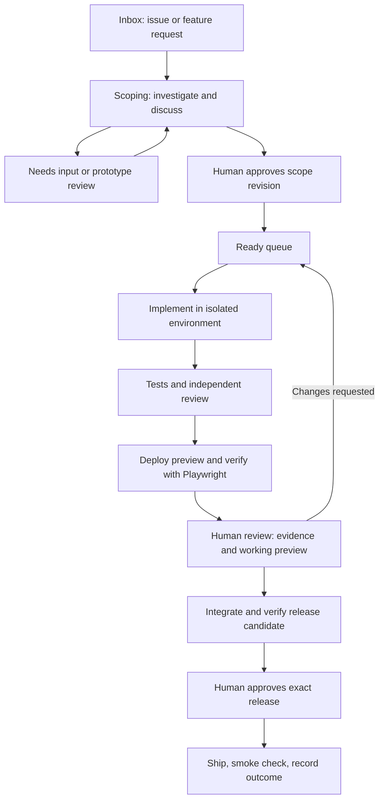
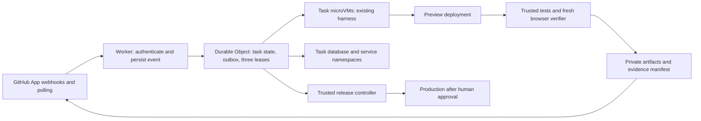

# A learning project harness with a GitHub development board

**Infrastructure update:** the owner's later preference is [Hetzner workers, personal
Claude Code subscription login, Coder workspaces and Vercel/Neon delivery](2026-11-13-hetzner-claude-subscription-development.md).
That note supersedes this managed pilot's provider selection. The board, testing,
approval and learning-loop requirements below remain useful.

Research date: 2026-11-13. Proposal, not an implemented service.
User constraints: compare managed and self-hosted infrastructure; favor a small
managed pilot; infrastructure budget $100/month. Model usage is budgeted separately.
Assumed initial stack: Next.js/React, Prisma/PostgreSQL.

## Questions

1. How can a project harness detect recurring failures and improve its rules,
   skills, agents and checks without weakening the tests or permissions judging it?
2. What primary evidence describes Anthropic's own BDD, E2E and other testing?
3. How can GitHub Projects support supervised investigation/scoping, at most three
   implementations, preview verification and explicit human approval to ship?
4. Which managed or self-hosted environments provide real isolation and fast
   application/data readiness within $100/month?
5. How do work survive crashes, duplicate webhooks, changing approvals, failed
   previews, stale data and long waits for a human?

## Findings and proposal

Build a small **GitHub-driven development service around the existing project harness**.
Use GitHub Issues/Projects for conversation and status, a durable controller for queueing
and approvals, disposable managed microVMs for agents, database branches for task data,
and deployed previews for verification and human review. Add measured harness improvement
after the delivery loop has real outcomes to learn from.

The recommended pilot is **GitHub Projects + Cloudflare Worker/Durable Object + Vercel
Sandbox/Pro previews + Neon + Playwright**. It can plausibly stay below $100/month at
modest on-demand usage, with model calls budgeted separately. It cannot supply three
always-running build/browser workspaces at that price. This is an architecture proposal;
no GitHub configuration, server, subscription, deployment or harness behavior was changed.

## What the research adds

| Already in tackroom | New work needed |
|---|---|
| Memory, transcript consolidation and dream proposals | Outcome attribution, baseline/candidate evaluations, canary promotion and rollback |
| Spec/task/verify skills and reviewer roles | GitHub conversation adapter, approved scope revisions, durable state transitions |
| Advice to run at most three sessions | An enforced global semaphore with leases, fencing and crash recovery |
| Worktrees and project startup guidance | Separate microVM/data namespaces, cached environment snapshots and a measured readiness contract |
| Behavior-oriented tests, locked tests, browser verification | Trusted acceptance baseline, exact-preview verification and evidence manifests |
| Human review before shipping | Server-enforced actor checks and approvals bound to the actual release revision |

The earlier [Anthropic staff audit](2026-11-13-anthropic-staff-setup-audit.md) covers the
new X posts, talks and public repository configurations. Three focused companion notes
cover this extension:

- [Adaptive harness and dream loop](2026-11-13-adaptive-harness-learning.md).
- [Claude team testing, BDD and E2E evidence](2026-11-13-claude-team-bdd-e2e.md).
- [Managed/self-hosted environments and cost calculation](2026-11-13-isolated-agent-environments.md).

All architecture and thresholds below are recommendations/inferences, not a claim that
Anthropic runs this exact stack. The public sources support the individual patterns.
The [source manifest](../sources/board-harness-2026-11-13.txt) lists 42 newly archived
items for this extension. It includes background and one degraded extraction; the
companion notes distinguish inspected evidence from untested leads. The refreshed
reference index contains 1,719 items, including the earlier staff-setup additions.

## Human-facing workflow



**Inbox → Scoping.** An issue-backed card moves into Scoping. The agent reads the issue,
relevant project docs/memory and code. For bugs it captures steps, actual/expected
behavior and evidence. For features it states the user problem, alternatives and
non-goals. It may produce a small interactive prototype with synthetic data. GitHub
issue comments carry questions, answers, prototype links and the evolving spec; the
board is a view of state, not the entire conversation.

**Production investigation.** A dedicated browser session may inspect production using
a scoped account or test tenant provided for that purpose. Keep this separate from the
code-writing worker and inject session access through the controller. Prefer read-only
inspection; any necessary state-changing reproduction must be explicitly scoped and
supervised. Reproduce locally against a sanitized fixture when possible. Do not copy
production data into a generic dev branch or let arbitrary task code inherit production
access. These are design assumptions because the data policy has not yet been specified.

**Scope approval.** The agent presents a compact spec: problem and evidence, target roles,
behavior examples, non-goals, UI/prototype choice, dependencies, data/migration effects,
test plan, rollout/rollback and unresolved questions. A human approves a specific spec
revision, for example `/approve-scope <revision>`. This syntax is proposed, not installed.
Changing behavior or acceptance after approval returns the task for a new approval.
Issue text and external comments are input data; they cannot grant access or override
controller policy.

**Ready → Implementation.** Select the oldest eligible task at its human-set priority,
with dependencies satisfied and no conflicting migration/shared-resource lock. Allocate
a slot, start the task environment, pin the harness/spec/memory versions, and run the
current implementation workflow. Existing reviewer roles are used selectively. Start
with one implementer and one fresh verifier, rather than spawning a permanent team
for every change. Budget and review-round limits apply to all child work.

**Preview verification → Human review.** Deploy the feature branch, bind the immutable
deployment URL/ID to its source SHA, seed/migrate isolated data, run Playwright acceptance
tests and a fresh user-perspective exploration. Attach evidence, then stop agent compute
and release the slot. The next Ready task can start while the human tests the retained
preview. Changes requested go through the queue again; they do not secretly launch a
fourth implementation.

**Integrate → Ship approval.** Parallel branches can each pass while breaking one another.
Serialize integration and test the combined release candidate. A merge/rebase or other
source change invalidates prior release evidence. For the pilot, a human can merge the
reviewed PR, then a trusted pipeline builds/verifies the resulting main revision in a
release-preview environment. Production deployment stays disabled until the human
approves that exact SHA and deployment/artifact ID, for example `/ship <sha> <id>`.
The controller checks both are current and verified. After deployment, run a small
production smoke check and preserve a rollback artifact; DB changes need their own
forward/rollback plan and cannot assume code rollback reverses a migration.

The review packet should fit in one GitHub summary comment: what changed, acceptance
criteria and their results, preview link, one short successful-journey video, screenshots,
failure traces/report links, independent findings, remaining limitations, exact versions
and rollback steps. Detailed logs remain attached rather than flooding the discussion.

## Runtime and queue design



The Worker is the always-available endpoint. A SQLite-backed Durable Object stores the
queue and state; long-running agent processes live in sandboxes, not inside a webhook
request. SQLite transactions can atomically reserve a slot. Alarms provide wakeups with
at-least-once execution, so every action must be repeatable. Cloudflare documents finite
alarm retries; use an independent periodic reconciliation trigger as well. [CF1, CF2]
The first spike must also prove the chosen Sandbox client/API works from the controller
runtime, including detached execution and reconnecting to a running command. An SDK
example that works in Node is not by itself proof of Worker compatibility.

Store durable records for tasks, runs, incoming events, outgoing actions, leases,
approvals and evidence. A run should contain:

```text
task ID + run ID + attempt/lease epoch
spec revision + accepted criteria/test baseline hash
source SHA + harness commit + memory snapshot + model/settings
environment image + seed version + database branch + sandbox ID
preview deployment ID/URL + source SHA + evidence manifest hash
human approval actor/time/revision + spend/time budget + terminal reason
```

### Enforce three active tasks, even during failures

- Reserve a slot transactionally **before provisioning**. Provisioning, implementation,
  local checks, agent review and preview verification occupy it. Count task workers
  globally, not one limit per webhook process or repository.
- Every run has a lease and increasing fencing epoch. Only the current epoch may
  publish results or request state transitions. Workers send heartbeats; the controller
  checks provider status as well.
- On lost heartbeat, mark recovery pending, revoke task access and confirm the old
  worker is stopped before reassigning its slot. If provider state is uncertain, retain
  the slot and surface the problem. An expired database lease alone does not stop a VM.
- Stop admission on budget exhaustion, repeated infrastructure failure or a growing
  human-review backlog. Use priority plus age so low-priority work is not starved.
- Blocked/waiting-for-human tasks checkpoint and stop. Review holds no implementation
  slot. Scoping/browser experiments and release verification borrow available compute
  slots during the pilot; do not create an unmetered parallel lane.
- Give external provisioning/deployment operations stable run identifiers. Persist
  intent before calling a provider, and reconcile ambiguous responses before retrying.
  A crash after resource creation must not create an orphan on every retry.

### GitHub-specific constraints

GitHub advises acknowledging webhooks within ten seconds and deduplicating by delivery
ID. It does **not** automatically redeliver failed webhook deliveries. Persist the event
before acknowledging, process asynchronously, and reconcile current board/PR/provider
state every few minutes. Delivery IDs prevent repeat processing; canonical state and
revision checks handle out-of-order events. Bot-generated comments/status updates must
not recursively trigger work. [GH1, GH2]

`projects_v2_item` is documented for **organization-level** Projects and is still a
public-preview webhook interface. Prefer an organization board for the pilot. If the
existing board is personal, use authenticated polling for card changes plus repository
issue/comment events; do not assume the organization event fires for it. The separate
`projects_v2_status_update` is project health reporting, not the card's Status field.
Use GraphQL field/option IDs to update card status, not legacy Projects classic columns.
Reconcile the UI with controller state, rejecting unauthorized state jumps. [GH3, GH4]

Only allowlisted humans can approve scope or shipping. A move to an approval-labelled
column is not enough if performed by a bot. Store the approving actor and revision;
edits, deleted/revoked approvals and changed candidates must be handled explicitly.
For the pilot use explicit revision-bearing comments for approvals; card drags express
intent and the controller confirms whether the transition is valid.

GitHub's environment protection has a plan trap: required environment reviewers on
Free/Pro/Team are documented for **public repositories**, while private-repo environment
secrets have different availability. Do not design the private pilot assuming Team
includes an environment approval gate. Use a trusted controller's release authorization
and protected main/required checks where available. Keep production deploy capability
out of worker-written workflows and task identities; an approval check implemented only
in code the agent can modify is not an independent gate. [GH5]

## Testing and self-improvement

Use BDD as the **human conversation about concrete behavior**, with ordinary integration
and Playwright Test automation. The research did not establish an Anthropic-wide
Cucumber/Gherkin standard. Their first-person material does support runnable verification,
fresh-context review, internal E2E skills, deterministic CI and risk-scaled human review.
The [testing note](2026-11-13-claude-team-bdd-e2e.md) separates those facts from proposed
implementation details and explains why a test healer must not skip its way to green.

The self-improvement loop starts with structured results from this delivery workflow.
Dream groups recurring failures and proposes one small rule/skill/agent/script change.
An evaluator compares it with the baseline on representative tasks, including held-out
cases and known-good behavior. A reviewer and human approve promotion; subsequent tasks
pin the new harness revision. Keep active tasks stable and roll back regressions.
Prefer deleting stale instructions or fixing tooling over multiplying agents.
See the [learning note](2026-11-13-adaptive-harness-learning.md) for evidence and safeguards.

The new Warp `issue-triage-loop` example is a useful starting reference for versioned
feedback and reviewed skill changes. `oz-for-oss` also documents a webhook control plane
with triage, scoping, implementation, review and verification roles. Inspect/reuse the
patterns; neither inspected README proves this proposal's exact three-slot scheduling,
data isolation or release guarantees. GitHub Agentic Workflows is another useful adapter
for scheduled research/dream jobs. Its Claude engine currently documents API or Copilot
inference, not subscription OAuth, and bare-mode settings need checking so the intended
project harness actually loads. Model billing remains separate. [O1, O2, O3]

## Budget and pilot acceptance

Allocate **$45 Vercel, $10 Cloudflare/storage, $15 Neon, $10 GitHub/CI, $20 contingency**.
This is $100 for incremental pilot infrastructure, excluding model usage and existing
production hosting. The [environment note](2026-11-13-isolated-agent-environments.md)
shows rates and arithmetic: 120 total monthly worker-hours at 2 vCPU/4 GB and 25% active
CPU yield about $18.26 of sandbox usage before previews and other services. At sustained
full CPU or high preview traffic the allocation must change. Use admission budgets and
cleanup, not just billing alerts. Coder/DevPod plus own-cloud VMs remains a plausible
alternative if operational control becomes more important than a small managed footprint.

Build in four increments, each with a concrete exit check:

1. **One project, one task, fixed harness.** A real bug goes from issue through supervised
   scope, isolated reproduction, regression test, preview evidence and explicit ship
   approval. Confirm actual account/region/API availability, exact app stack and data
   policy during setup. No self-improvement yet.
2. **Reliable queue and environments.** Raise the cap to three. Replay a webhook twice,
   deliver events out of order, kill a worker, restart the controller, lose a callback,
   exhaust the budget and expire a preview. Each must recover without duplicate writes,
   a fourth worker, leaked resources or shipping an unapproved revision. Measure 20
   environment starts and demonstrate one task cannot read another task's DB/files.
3. **Trustworthy verification.** Deliberately inject a behavioral bug, a weakened test,
   a skipped acceptance case and a stale-preview result. The release gate must reject
   all four. Confirm review includes the passing video, failure trace when applicable,
   fresh-user findings and the final integrated revision. Exercise rollback.
4. **Measured learning.** Collect about 20 completed tasks with explicit feedback; run
   one dream candidate in shadow evaluation. Demonstrate a useful improvement without
   regressions or excess cost, then manually promote and test rollback. Until then,
   "self-improving" is a design intention, not a measured property.

Do not fold the controller into tackroom's baseline distribution machinery. Keep it a
separate service consuming project-owned harness revisions. Tackroom remains the
manually copied baseline and research library; no project registry/sync is implied.

## Additional primary sources

Companion notes contain provider, Anthropic, Playwright and learning-source registers.
The following documents support the control-plane details; publishers are the authors,
all are living documentation checked 2026-11-13. Specific sections were inspected;
the very large webhook reference was not read end-to-end. No claimed provider behavior
was tested against a live account. All saved files below are under `refs/articles/`.

| Key | Source | Saved file and locator |
|---|---|---|
| GH1 | GitHub, [webhook best practices](https://docs.github.com/en/webhooks/using-webhooks/best-practices-for-using-webhooks) | `docs.github.com/en-webhooks-using-webhooks-best-practices-for-using-webhooks/article.md`; respond within ten seconds, delivery ID |
| GH2 | GitHub, [failed webhook deliveries](https://docs.github.com/en/webhooks/using-webhooks/handling-failed-webhook-deliveries) | `docs.github.com/en-webhooks-using-webhooks-handling-failed-webhook-deliveries/article.md`; no automatic redelivery |
| GH3 | GitHub, [webhook events](https://docs.github.com/en/webhooks/webhook-events-and-payloads#projects_v2_item) | `docs.github.com/en-webhooks-webhook-events-and-payloads/article.md`; projects_v2_item and projects_v2_status_update |
| GH4 | GitHub, [Projects API](https://docs.github.com/en/issues/planning-and-tracking-with-projects/automating-your-project/using-the-api-to-manage-projects) | `docs.github.com/en-issues-planning-and-tracking-with-projects-automating-your-project-using-the/article.md`; updateProjectV2ItemFieldValue; checked through Context7 too |
| GH5 | GitHub, [deployment protection](https://docs.github.com/en/actions/reference/workflows-and-actions/deployments-and-environments) and [environment setup](https://docs.github.com/en/actions/how-tos/deploy/configure-and-manage-deployments/manage-environments) | `docs.github.com/en-actions-reference-workflows-and-actions-deployments-and-environments/article.md` and `docs.github.com/en-actions-how-tos-deploy-configure-and-manage-deployments-manage-environments/article.md`; required reviewers and prerequisites |
| CF1 | Cloudflare, [SQLite transactions](https://developers.cloudflare.com/durable-objects/api/sqlite-storage-api/) | `developers.cloudflare.com/durable-objects-api-sqlite-storage-api/article.md`; transactionSync |
| CF2 | Cloudflare, [alarms](https://developers.cloudflare.com/durable-objects/api/alarms/) | `developers.cloudflare.com/durable-objects-api-alarms/article.md`; Background, retry semantics |
| O1 | Warp maintainers, [Oz for OSS](https://github.com/warpdotdev/oz-for-oss) | `github.com/warpdotdev-oz-for-oss/article.md`; README platform overview, architecture lead only |
| O2 | GitHub, [Claude engine](https://github.github.com/gh-aw/engines/claude/) | `github.github.com/gh-aw-engines-claude/article.md`; authentication and limitations |
| O3 | GitHub, [Claude engine reference](https://github.github.com/gh-aw/reference/engines/claude/) | `github.github.com/gh-aw-reference-engines-claude/article.md`; bare mode and project instruction loading |

This research does not make a binding infrastructure decision. The first vertical slice
and measured environment startup/cost results should decide whether to keep this stack.
