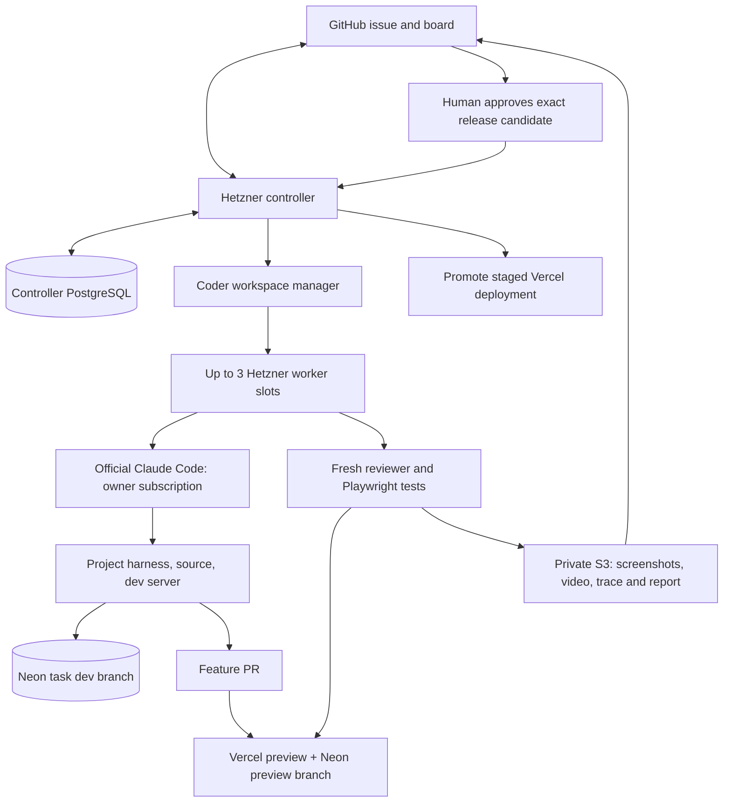

# Hetzner workers, Claude subscription and Vercel delivery

Research date: 2026-11-13. Latest owner direction: run the official Claude Code CLI
on owned Hetzner machines, sign in with the owner's subscription, and keep Vercel/Neon
for the application. Use the owner's existing S3 storage for artifacts. No AI Gateway.
Research/design only; nothing deployed.

Updated 2026-11-14 after the owner's requirements review. The
[requirements audit](2026-11-14-agent-development-requirements.md) specifies native
session takeover/laptop handoff, GitHub questions and review replies, storage without
S3, exact preview testing and product-impact scoping. It is part of this proposal.

The [multiple-project clarification](2026-11-14-multiple-projects-workers-and-build-costs.md)
adds a shared worker pool, portable project onboarding, live server prices and build
placement. Start with one worker; the cap of three is global across projects. Vercel
is the deployment adapter for projects already using it, and Hetzner is a replaceable
execution provider. Neither is a mandatory dependency of the copied project harness.

## Questions

1. How does ordinary Claude Code subscription login work in a remote worker image?
2. Does Coder help this personal workflow enough to justify operating it?
3. How can three workers preserve login while resetting task state and isolating work?
4. Which board, testing, preview, approval and learning mechanisms should remain?
5. What is the smallest implementation and what must be verified on actual machines?

## Recommendation

**Use Hetzner for the development workers and controller, your signed-in Claude Code
CLI for coding, and Vercel + Neon for previews and production.** Add Coder Community
for workspace management and human terminal/IDE access. Keep a small custom board
controller because Coder alone does not implement our approval, testing and release
contract.

This supersedes the deployment and model-access recommendation in the
[Vercel-native alternative](2026-11-13-vercel-native-agent-development.md). Remove AI
Gateway, API-credit funding assumptions, Vercel Sandbox, Vercel Workflow/Queues,
Cloudflare and R2 from the preferred pilot. Vercel still hosts the product. There is
no reason to force the coding computer onto the application hosting platform.

**Inference:** this is a good fit for one owner's projects and existing servers. It
trades managed worker operations for predictable, persistent personal development
machines. It does not create unlimited model capacity or a service for other people
to consume the owner's subscription.

## Evidence that changes the design

| Finding | Consequence |
|---|---|
| Anthropic documents personal subscription authentication in the official CLI, including remote browser completion and persistent container login. [A1] | Sign in on each worker through Claude's own flow; no model gateway is needed |
| Anthropic's current support guidance permits personal SDK/`claude -p` use against plan limits. Its authentication guidance distinguishes personal use from serving other users. [A3, A4] | Design this as the owner's private development automation, using the unmodified CLI |
| An API key in the environment takes precedence over subscription login. [A5] | Startup must verify the intended auth method; do not silently switch to API billing |
| Current `--bare` mode skips subscription login and much of the project harness. [A2] | Do not use it for this runner; pin and test CLI behavior before upgrades |
| Current Coder Agents is a separate agent implemented in Go, not a Claude Code wrapper. [C2] | Use ordinary Coder workspaces running Claude Code; do not substitute the Coder Agents model loop |
| Coder's managed pool of prebuilt workspaces requires Premium. [C4] | Community pilot uses ordinary fixed worker slots plus cached images; no Premium prebuild dependency |
| Hetzner bills allocated Cloud servers even while powered off. [Z2] | A stopped worker frees capacity, not its monthly server bill |

## Where each component lives

| Component | Location and responsibility |
|---|---|
| GitHub Issues + Project | Requests, scope discussion, approvals, status and PR links |
| Controller | Small Node/TypeScript service on a trusted Hetzner control host; webhook API, scheduler, reconciliation and release gate |
| Persistent state | PostgreSQL on the control host, with backups; separate databases/roles for controller and Coder, never application preview data |
| Coder Community | Same control host initially; workspace templates, terminal/IDE access and lifecycle management |
| Worker slots 1–3 | Prefer one dedicated Hetzner VPS per slot; official Claude Code, project harness, dev server and browser tools |
| Application environments | Vercel feature deployments and staged production deployments |
| Application data | Neon safe seed plus distinct dev and preview branches per task |
| Evidence and session checkpoints | Existing private S3; persistent controller disk or Vercel private Blob if S3 is absent; authenticated access through the controller |
| Harness improvement | A low-priority job using a free slot, proposing reviewed changes to the project harness |



The controller is an ordinary state machine with durable database records. It makes
no model calls itself. A service supervisor restarts it; an outbox and reconciler
recover unfinished operations. Approvals can wait for days without a live Claude
process. Redis, Kubernetes, Temporal and a second workflow engine are unnecessary
for three workers in this first version. These are design choices, not vendor claims.

## What Coder adds, and what it does not

Coder ships a Docker deployment and a Compose example with PostgreSQL. Its installation
guide lists 2 CPU cores and 4 GB free memory for that setup; this is **not** the resource
budget for three Next.js builds and browsers. Use a pinned release and a separate,
persistent PostgreSQL service for the control plane. [C1]

**Recommendation:** start with Coder Community if browser terminal/IDE access is useful
for login, debugging and taking over a task. Keep the worker adapter small enough that
direct SSH plus a supervised runner can replace Coder if its operational overhead
outweighs those benefits. DevPod remains an alternative environment launcher, but does
not remove the need for the board controller.

Do not implement this against old Coder Tasks examples without checking the installed
version. Current Coder Agents has its own model runtime and licensing. Its documented
five-active-agent Community limit belongs to that product; it is not our required
three-implementation semaphore. We are launching external Claude Code processes in
workspaces, so the board controller owns that limit. [C2, C3]

Coder templates and provisioning access belong to the trusted control service. Task
code must not edit templates or access host Docker sockets. Use a separate origin for
workspace apps rather than serving arbitrary app pages under the Coder administration
origin. Coder's security guide explains the template privileges and origin risks. [C5]

## Image, login and isolation

### The reusable image

Build a project worker image with a pinned Linux base, Node, package manager, Git,
the official Claude Code binary, Playwright browsers/system dependencies, and a small
runner. Install tools during image build, not at the beginning of every task. Keep
project dependency layers keyed by lockfile, runtime, architecture and image revision.

The image contains **no account login, task history, production access or live data**.
The controller selects an approved image and harness revision for each attempt. An
image update goes through its own compatibility check before replacing the working one.
Choose x86-64 initially unless the existing hosts and browser dependencies have been
verified on ARM. Hetzner snapshots cannot cross architecture types. [Z1]

### Initial sign-in

Open a Coder terminal or SSH session as the worker's ordinary user and run `claude`
or `claude auth login`. Complete the official login URL in your local browser. Check
`/status` to confirm the subscription. This is done by the owner; the controller does
not collect the browser login. Preserve the CLI's private configuration directory on
that slot's storage, outside disposable task checkouts. Separate slots use separate
directories and independent sign-ins. Re-authentication is an expected maintenance
state. [A1]

Prefer this interactive bootstrap over distributing an extracted token. Anthropic also
documents `claude setup-token` for scripts, but this pilot does not need it. Never
put a signed-in home directory into the reusable image or clone one login volume into
concurrent workers. Confirm no API/gateway configuration overrides the login. [A1, A5]

### Fresh task state with persistent login

**Design:** separate immutable tools, slot-private login, task filesystem, native task
session history, and approved project memory. Each new task gets a fresh source checkout,
container writable layer, browser profile and data identity. Before releasing its slot,
preserve its native transcript, required session files and intended code changes in a
private task checkpoint. Failed checkpointing blocks cleanup. Reset processes and ports
before admitting another task; restore only that task's history when it returns.
Global settings, plugins and automatic memory must not become an unreviewed channel
between unrelated tasks. Validate this contract against the pinned CLI. Do not hand-edit
the CLI's authentication data. The requirements audit defines the takeover protocol.

For the earlier requirement of strong concurrent isolation, prefer **three separate
worker VPSs**, with the trusted controller on another existing host. If only one worker
VPS is available, start with one active task. Three ordinary Docker containers on one
VPS share its kernel and do not provide the same boundary. Avoid assuming nested
virtualization is available on a rented VPS. A bare-metal microVM setup is a later
alternative, not necessary for this pilot.

Persistent personal login is a practical compromise: code executing with the same user
rights as the CLI may reach its local account state. Containers and file modes do not
magically hide that state from all tool execution. Run only owner-approved repository
work; keep test/build execution in a separate container without the login mount where
feasible. A suspected compromise quarantines the slot and requires revocation/rebuild.
Do not present this as a disposable, hostile-code service with perfect reset guarantees.

Keep Coder admin, Hetzner administration, control DB access and production promotion
authority outside workers. Firewall workers from each other and unrelated services on
the user's existing VPSs. Coder's workspace guide requires deliberate network and
privilege boundaries; its UI alone does not establish them. [C5]

## The CLI runner

Use the TypeScript Claude Agent SDK as the interaction adapter around the official
CLI, with task text passed as data. Retain the explicit session ID and native session
files. Resume that ID after feedback, never whichever session is most recent on a reused
worker. Explicitly load the Claude Code prompt preset, approved project settings and
harness. Keep the owner's subscription authentication. Do not use `--bare`: current
behavior disables the subscription/harness combination we want. Pin the CLI/SDK pair
and verify its behavior before upgrades. [A2, A3; requirements audit I1/I3]

**Implementation contract:** use `-p`, structured output, explicit project settings and
phase-specific allowed tools. The supervisor owns the dev server, timeout and process
tree. It distinguishes a completed task from an auth error, usage limit, missing tool,
permission denial or incomplete structured result. Exit status alone is insufficient.
Required hooks, skills and MCP servers get startup checks. No blanket permission bypass
is needed as the default.

The input bridge is a first-version requirement: route Claude questions/permissions
through `canUseTool`, MCP input through `onElicitation`, and human replies through the
controller back to the pending request. Ordinary completed turns may also return a
structured `needs_input` result. Persist request IDs and answers; use supported deferred
tool calls for long waits, with the limitations and restart protocol in the requirements
audit. A live callback alone is not durable. Unsupported terminal prompts require Coder
takeover. A fresh summarized session is an explicit recovery fallback, not a substitute
for continuing the actual session.

All sessions share the owner's subscription allowance, including laptop use and nested
reviewers. On a usage-limit signal, stop admission and put work into **Waiting for
capacity**; resume at the reported reset if available, otherwise after owner action.
On expired login, use **Needs login**. Do not retry indefinitely or switch billing modes.
Start with one implementation and sequential reviewers, then raise the cap to three
if actual subscription headroom and machine memory support it. [A3; scheduling inference]

## Board workflow and the three-task limit

```text
Inbox → Scoping ↔ Needs input / Prototype review
      → Scope approved → Ready
      → Implementing [maximum 3 active task slots]
      → Local checks → Independent review → Preview E2E
      → Human review [worker released]
      → Staged release → Ship approval → Promoted → Done

Any active phase → Needs login / Waiting for capacity / Blocked
Human rework → Ready with a new approved revision
```

Use `tasks`, `attempts`, `worker_slots`, `events`, `outbox`, `approvals`,
`pending_interactions`, `session_checkpoints`, `resource_bindings`, `artifacts` and
`outcomes` tables. Claims are short Postgres
transactions with row locks; enforce one active attempt per task and exactly three
slot records. The board is a view and command surface, not the source of locking.

Workers pull authenticated job envelopes and send heartbeats/results through a narrow
controller API; they never receive a control database connection. Give every operation
a stable ID and every claim a fencing epoch. Deduplicate GitHub deliveries and persist
an outbox before acknowledging them. Reconcile missing events and ambiguous external
operations after restarts. Retain the earlier personal-board polling fallback where
the required Project event is unavailable.

A task holds its slot through preview verification. Stop its builder before starting
its independent verifier in the same slot; verification is a fresh process/context and
clean checkout, with trusted acceptance definitions. The verifier cannot count modified
or skipped required tests as success. Enforce a separate subprocess/subagent limit:
three top-level tasks must not each spawn an unbounded agent team.

At human review, stop compute, persist evidence and a resumable task checkpoint, clean
the task runtime and free the slot for the next Ready item. Keep its Vercel preview and Neon preview data available
until expiry. A lost heartbeat does not release capacity until termination is confirmed.
Scoping and dream jobs borrow free slots, with implementation work taking priority.
When the owner takes over, stop the automated writer and transfer exclusive ownership
to the human. Retain that task's logical slot until it returns or is safely suspended;
the queue must not start a fourth implementation. Coder terminal and laptop SSH access
keep execution on the worker. Actual laptop execution requires explicit session/code
transfer and a return handoff. All these queue semantics are implementation recommendations.

Scope and ship approvals must come from authorized GitHub actors and identify the
revision being approved. A bot comment, arbitrary issue text or a column move alone
must not authorize production. Changed source, tests, migrations or scope invalidates
the affected approval. The controller, not the agent's prose, enforces transitions.

Before Ready, require the requirements audit's impact map: current flows, similar
components, shared consumers, data/integrations, relevant states/roles and regression
proof. Before Human review, post a revisioned implementation report explaining
architecture, data changes, tests, performance and decisions. Proposed GitHub commands
such as `/agent review R3 changes` queue attributed feedback for the same task session;
`/agent review R4 approve` accepts the report but does not authorize production release.

## Vercel, Neon and verification: retain these parts

1. **Investigate with limited production access.** During scoping, Playwright may inspect
   the real app through an appropriate account. Record reproduction and expected behavior.
   Use a test tenant or safe read-only paths; production data is not automatically a
   development seed. Keep this browser session out of the implementation worker.
2. **Separate development and preview data.** Use a sanitized/synthetic Neon parent.
   The native Vercel integration branches from the default Neon branch, so confirm that
   parent and the separately selected production branch. Use a separate dev branch for
   the worker. Track the exact deployment-to-preview-database mapping. [N1]
3. **Measure real readiness.** Restore dependencies, migrate/seed the task database,
   start the dev server and authenticate a test account. Record timings for each step.
   A proposed target is warm p95 under 60 seconds for the initial small app; it is a
   target to test, not a vendor guarantee. Keeping three prepared slots avoids VM creation
   and browser installation in the normal task path.
4. **Test behavior at appropriate levels.** Keep Given/When/Then acceptance examples,
   focused unit/integration checks and Playwright E2E for critical user journeys. No
   evidence from the earlier Anthropic audit justifies adding Cucumber automatically.
   The [testing note](2026-11-13-claude-team-bdd-e2e.md) remains the source for that decision.
5. **Verify deployed behavior.** A clean reviewer examines the implementation and a
   browser verifier tests the exact Vercel deployment URL. The controller obtains it
   from a signed deployment event, verifies project/source/deployment through the API,
   and gives it to Playwright as its base URL. Use `deployment.succeeded` with a separate
   GitHub acceptance check in the pilot; a blocking Vercel Check instead requires the
   earlier `deployment.ready` event. See the requirements audit for event semantics,
   stale-event rejection and readiness gates. Collect deterministic test
   results, screenshots, a short passing-journey video and failure traces. Bind evidence
   to source, spec, tests, harness, seed and deployment revisions. Vercel protection
   bypass is separate from application login; scope it to the intended host. [V1]
6. **Human review.** Restore a documented fixture for exploration, stop automated
   mutations, and link private evidence from the issue. The controller authenticates
   the reviewer and issues a short-lived S3 download URL; do not make account/session
   recordings public. [S1]
7. **Ship the approved artifact.** Disable automatic production-domain assignment during
   setup, integrate reviewed work serially, build a staged production deployment and
   request approval of its exact ID. Preview promotion rebuilds; staged promotion does
   not. Production-safe smoke checks and explicitly approved migrations belong to this
   stage, not destructive E2E. Only the trusted controller promotes it. [V3]

**S3 artifact contract (design):** use a dedicated bucket or project prefix in the
existing store. Workers receive short-lived uploads scoped to individual staging
objects, not bucket-wide access. The controller verifies checksums and copies accepted
artifacts into a final prefix that workers cannot overwrite, then records object keys
and hashes in the evidence manifest. S3 presigned URLs can be reused until expiry and
uploads can replace an existing key, so a unique filename alone does not seal evidence.
GitHub stores a stable authenticated controller link, not the expiring bearer URL. [S1]

Use configurable endpoint, region and bucket settings. If the existing service is
S3-compatible rather than AWS S3, verify signing, checksum and retention behavior
against that provider during the spike; AWS-specific policy features are not assumed.
Retention applies only to the harness artifact prefix, not unrelated existing objects.

**Without S3:** use private persistent controller disk for the smallest pilot, or Vercel
private Blob for managed object storage. Both must preserve session checkpoints and
sealed evidence, authenticate review access and implement backups/retention as appropriate.
Do not use disposable worker storage. The requirements audit compares these options;
existing S3 remains the default when available.

Expire task databases, previews, local workspaces and large recordings explicitly.
Retain small evidence manifests and outcomes longer. A proposed limit of six pending
human reviews keeps idle previews from growing indefinitely.

## Self-improvement stays reviewable

Retain the [adaptive-harness design](2026-11-13-adaptive-harness-learning.md): record
reviewer corrections, escaped defects, flaky checks, startup delay and wasted retries.
A bounded dream pass identifies repeated problems and proposes one rule, skill, agent
or removal at a time. Compare the candidate with the current harness on held-out tasks.
Promote it through human review; pin active tasks to their original revision.

The worker image, controller, release rules and approval identities are outside that
self-editing scope. Changes to those require a separate infrastructure change. Learning
can improve the work without allowing an agent to redefine what counts as approval or
passing verification. This remains a project-local harness, not a tackroom registry.

## Budget and implementation sequence

The earlier $100 is an **incremental infrastructure ceiling**, with already-paid
Vercel, Claude and existing Hetzner servers itemized separately. Do not assume existing
servers have spare capacity: their CPU/RAM, architecture and current workloads have
not been inspected. Planning assumptions, not vendor sizing promises: one control host
with roughly 2 vCPU/4 GB plus disk/backups; each active build/browser slot initially
roughly 4 vCPU/8 GB, adjusted after measurements. Start with one slot if capacity is tight.

| Incremental reserve | Monthly planning ceiling |
|---|---:|
| Additional worker capacity, disk and control-host backup | $50 |
| Vercel preview builds/runtime beyond existing allowance | $15 |
| Neon dev/preview branch usage | $15 |
| Incremental S3 evidence storage, requests and transfer | $5 |
| Contingency | $15 |
| Total | **$100** |

These are allocations, not a quote for three new servers. If suitable VPS capacity
already exists, the first row may be much lower. If it does not fit, reduce concurrency
before buying additional machines. Powering off Hetzner Cloud servers does not stop
their allocation charges; deletion does, while retained storage can still cost money.
Do not enable destructive auto-delete for existing personal servers. [Z2]

Build this in a separate infrastructure repository. Suggested deliverables:

```text
control/             webhook API, scheduler, outbox, release and evidence access
db/                  migrations for attempts, three slots, approvals and outcomes
worker-image/        pinned image and dependency/browser preparation
runner/              job protocol, CLI adapter, supervision and result parsing
coder/               reviewed workspace templates, no model gateway
ops/                 deployment, backup, restore and worker quarantine runbooks
acceptance/          controller recovery and end-to-end pilot scenarios
```

1. **One-worker spike:** deploy the image to an unused worker environment; owner signs
   in; prove subscription authentication, harness loading, restart/login persistence,
   fresh-task cleanup and authenticated app readiness. Prove native CLI takeover/return,
   question handling and session/code checkpoints before worker recycling. Then verify
   explicit laptop handoff. No production changes.
2. **One real delivery:** issue → supervised scope → implementation → preview tests and
   fresh review → evidence → human approval. Keep release manual until the exact staged
   deployment and rollback procedure are demonstrated.
3. **Durable queue:** implement transactional claims/outbox/reconciliation. Inject worker
   death, controller restart, duplicate delivery, stale approval and failed cleanup.
   Verify a fourth task cannot start and an ambiguous worker is not replaced early.
4. **Three-slot proof:** measure RAM, browser/build latency and subscription exhaustion;
   prove concurrent workers cannot read one another's task data or reach control storage.
   Exercise expired login and permission-denied recovery without changing billing mode.
5. **Controlled release and learning:** automate promotion only after actor/revision gates
   work. Add the dream/evaluation loop after real completed outcomes exist.

## Sources and validation limits

Primary sources accessed 2026-11-13. New Claude authentication/headless pages and Coder
installation/Agents/licensing/security pages were read in full, as were the Hetzner
server FAQ and billing FAQ. Long pages sometimes omit code blocks or headings in the
saved extraction; cited behavior is in their prose, with live docs also checked.
The incorrect Coder security URL returned a 404; that newly fetched item was removed
and replaced by the canonical security guide. Existing Vercel/Neon research is reused.

The [source manifest](../sources/hetzner-subscription-harness-2026-11-13.txt) lists ten
new saved pages, including the S3 follow-up. The preceding managed-platform investigation added
[19 sources](../sources/vercel-native-harness-2026-11-13.txt), including the reused
Vercel/Neon release evidence.

| Key | Publisher, date and primary URL | Saved file under `refs/articles/`; locator |
|---|---|---|
| A1 | Anthropic, 2026-11-12, [Authentication](https://code.claude.com/docs/en/authentication) | `code.claude.com/docs-en-authentication/article.md`; login, management, precedence, expiry |
| A2 | Anthropic, 2026-11-12, [Run programmatically](https://code.claude.com/docs/en/headless) | `code.claude.com/docs-en-headless/article.md`; bare mode, structured results, permissions, resume |
| A3 | Anthropic, update 2026-10-07, [SDK with a Claude plan](https://support.claude.com/en/articles/15036540-use-the-claude-agent-sdk-with-your-claude-plan) | `support.claude.com/en-articles-15036540-use-the-claude-agent-sdk-with-your-claude-plan/article.md`; personal SDK/CLI usage |
| A4 | Anthropic, 2026-10-30, [Legal/authentication guidance](https://code.claude.com/docs/en/legal-and-compliance) | `code.claude.com/docs-en-legal-and-compliance/article.md`; individual use and hosted official binary |
| A5 | Anthropic, 2026-05-05, [API-key precedence](https://support.claude.com/en/articles/12304248-manage-api-key-environment-variables-in-claude-code) | `support.claude.com/en-articles-12304248-manage-api-key-environment-variables-in-claude-code/article.md`; subscription and `/status` |
| C1 | Coder, living documentation, [Docker installation](https://coder.com/docs/install/server/docker) | `coder.com/docs-install-server-docker/article.md`; requirements, Compose, database |
| C2 | Coder, living documentation, [Coder Agents](https://coder.com/docs/ai-coder/agents) | `coder.com/docs-ai-coder-agents/article.md`; what it is/isn't, architecture |
| C3 | Coder, 2026-08-18, [Agent licensing](https://coder.com/docs/ai-coder/agents/licensing-usage) | `coder.com/docs-ai-coder-agents-licensing-usage/article.md`; five-agent pool, external-agent distinction |
| C4 | Coder, living documentation, [Prebuilt workspaces](https://coder.com/docs/admin/templates/extending-templates/prebuilt-workspaces/) | `coder.com/docs-admin-templates-extending-templates-prebuilt-workspaces/article.md`; prerequisites, also checked with Context7 |
| C5 | Coder, guide dated 2024-12-16, [Security practices](https://coder.com/docs/tutorials/best-practices/security-best-practices/) | `coder.com/docs-tutorials-best-practices-security-best-practices/article.md`; template trust, workspace network and app origins |
| Z1 | Hetzner, living FAQ dated 2024-09-12, [Server FAQ](https://docs.hetzner.com/cloud/servers/faq/) | `docs.hetzner.com/cloud-servers-faq/article.md`; architecture, snapshots, cloud-init |
| Z2 | Hetzner, living documentation, [Billing FAQ](https://docs.hetzner.com/cloud/billing/faq/) | `docs.hetzner.com/cloud-billing-faq/article.md`; powered-off servers |
| N1 | Neon, 2026-10-23, [Vercel-managed integration](https://neon.com/docs/guides/vercel-managed-integration) | `neon.com/docs-guides-vercel-managed-integration/article.md`; preview parent and production selection |
| V1 | Vercel, 2026-09-16, [Automation bypass](https://vercel.com/docs/deployment-protection/methods-to-bypass-deployment-protection/protection-bypass-automation) | `vercel.com/docs-deployment-protection-methods-to-bypass-deployment-protection-protection-by/article.md`; protected preview access |
| S1 | AWS, living documentation accessed 2026-11-13, [S3 presigned URLs](https://docs.aws.amazon.com/AmazonS3/latest/userguide/using-presigned-url.html) | `docs.aws.amazon.com/amazons3-latest-userguide-using-presigned-url-html/article.md`; scoped upload/download, expiry, reuse and replacement |
| V3 | Vercel, 2026-06-26, [Deployment promotion](https://vercel.com/docs/deployments/promoting-a-deployment) | `vercel.com/docs-deployments-promoting-a-deployment/article.md`; preview rebuild, staged promotion |

Documentation supports product behavior; the queue, isolation policy, allocations and
milestones above are our design inferences. No VPS/account inventory, image build,
Claude model run, login, browser test or deployment was performed. The architecture is
ready for a one-worker implementation spike, not yet operationally validated.
