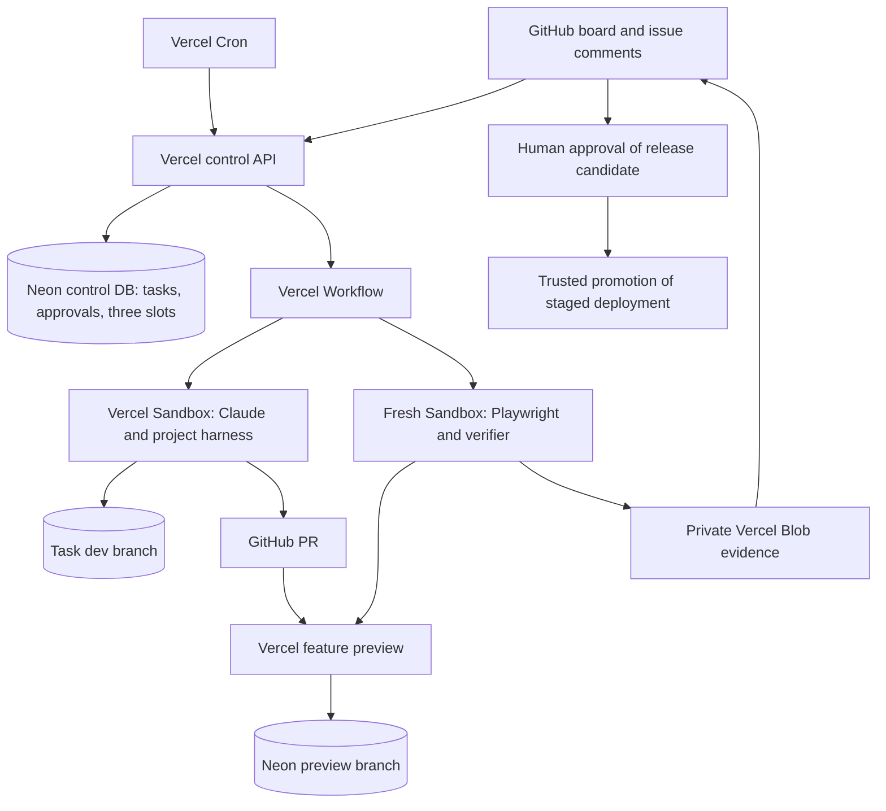

# Vercel-native agentic development for one project

**Alternative, superseded for the current use case:** the owner subsequently chose
Claude Code subscription login on owned Hetzner machines and explicitly excluded AI
Gateway. Use the [Hetzner/subscription proposal](2026-11-13-hetzner-claude-subscription-development.md)
as the implementation direction. This note preserves the managed comparison and the
Vercel/Neon release research; its API-funded Sandbox recommendation is not selected.

Research date: 2026-11-13. Revises the earlier multi-provider proposal for an existing
Vercel Pro application, Neon, GitHub, and an individual Claude Max or Ultra plan.
Research and implementation design only; no services are provisioned or changed.

## Questions

1. Which Vercel services replace the Cloudflare controller, queue and artifact store?
2. What can Claude Max/Ultra fund, and which authentication route fits an unattended service?
3. How do Workflow, Sandbox and Neon cooperate without duplicated work or more than three workers?
4. How do previews, test data, deployment protection and explicit production approval fit together?
5. What should be removed, retained and implemented first, and what costs remain?

## Recommendation

Use **Vercel Functions + Workflow + Sandbox + private Blob**, with **Neon** for the
controller database and task databases. Keep GitHub as the board/conversation interface
and Claude Code/Agent SDK as the coding harness. Remove Cloudflare, R2, Coder and a
separate VPS from the default design.

This keeps application hosting and agent infrastructure on Vercel. GitHub, Neon and
Anthropic remain service dependencies; "Vercel-only" does not mean Vercel owns the
model or PostgreSQL service. Neon can be billed through Vercel's Marketplace. All
architecture choices below are recommendations, not deployed behavior.

## Subscription and model access: an important update

Anthropic currently documents **$100 monthly API credits for eligible Max plans and
$200 for Ultra**, claimed into a linked Console organization. They are separate from
interactive subscription limits, expire each billing cycle, and require eligibility
and linking. The credits cover your own API-key-authenticated Agent SDK and `claude -p`
runs; the official Claude Code GitHub Action has different eligibility. Confirm the
grant in Console before budgeting against it. [C1]

The support article also says personal SDK/`claude -p` use signed into the Claude plan
continues to draw from subscription limits. Therefore, a blanket statement that
"headless always requires separate paid API usage" would be wrong. For this unattended
service, use a key from the linked Console organization: Anthropic's service-building
guidance recommends API authentication, while ordinary personal subscription use has
its own rules. Do not build a mechanism that copies or intermediates browser session
tokens. [C2, C3]

**Recommended initial route:** Agent SDK inside Sandbox → Anthropic directly, using
your linked organization's API key. Use a dedicated workspace/spend limit. Your own
interactive scoping and reviews can continue using the subscription. Pause new runs
when the API allocation is exhausted; do not assume three parallel agents have three
independent subscription allowances.

**Optional Vercel AI Gateway route:** BYOK can use that same provider-funded credit.
However, current Gateway docs say BYOK requires purchased Gateway credits, provider-key
failure can fall back to Vercel-funded requests, and BYOK spend does not accumulate
toward Gateway budgets. Restricting the provider does not disable that fallback.
Therefore direct Anthropic is simpler for the first budget-controlled pilot. If adding
Gateway, inspect the actual credential source in logs and Anthropic billing, and budget
fallback separately; a successful response does not prove it used the grant. [G1]

## Components to keep, replace and postpone

| Responsibility | Revised implementation | Reason |
|---|---|---|
| Board and discussion | Existing GitHub Projects and Issues | Keep human supervision where tasks already live |
| Webhook/control API | Separate Next.js project on Vercel, Node runtime | Trusted service, independent of product preview code |
| Durable orchestration | Vercel Workflow | Pause for approvals, resume on events, retry steps |
| Queue, approvals, leases, outcomes | Separate Neon control database | Transactional global limit and durable business records |
| Coding/browser execution | Vercel Sandbox | Isolated process/filesystem environment with prepared images |
| Product previews | Existing Vercel application project | Native feature-branch deployments |
| Dev/preview data | Neon branches from a safe seed | Fast setup with explicit data isolation |
| Videos, traces, screenshots | Private Vercel Blob store | Protected, immutable evidence linked from GitHub |
| Reconciliation and cleanup | Vercel Cron starts bounded maintenance work | Recover missed callbacks and delete expired resources |
| Model runtime | Existing Claude harness through Agent SDK | Preserve our skills, rules, hooks and reviewers |
| Self-improvement | Scheduled, bounded dream/evaluation workflow | Changes the next harness revision through review |

Remove the Cloudflare Durable Object/R2 design. Do not add Redis, Coder, Kubernetes,
another workflow engine, or a separate custom message queue. Workflow already uses
Vercel Queues; our Postgres tables hold task intent and leases, rather than reimplementing
the Workflow event log. Do not replace the Claude coding loop with an AI SDK agent loop
just because Workflow offers one. [W1]

Keep the control service in its own repository/project for the pilot. A product task
must not be able to edit the approval API or gain access to the controller database.
Project-specific harness files remain in the application repository, pinned per task.
No tackroom project registry, synchronization or automatic baseline rollout is added.



## Implement the controller as a small application

Suggested layout in a **new control-service repository**, not files added to tackroom:

```text
app/api/github/webhook/route.ts       verify and persist GitHub events
app/api/vercel/webhook/route.ts       deployment status ingestion
app/api/runs/[id]/events/route.ts     authenticated worker events
app/api/artifacts/[id]/route.ts       authorize evidence viewing
app/api/cron/reconcile/route.ts       replay outbox, find orphaned work
app/api/cron/cleanup/route.ts         expire previews, branches and artifacts
workflows/development.ts             task lifecycle and human waits
workflows/improvement.ts             bounded dream/evaluation candidate
steps/scheduler.ts                   transactional slot ownership
steps/sandbox.ts                     create, inspect, stop, checkpoint
steps/preview.ts                     resolve deployment and database
steps/verification.ts                trusted tests and evidence checks
steps/release.ts                     exact-candidate approval and promotion
lib/github.ts                       GitHub App adapter
lib/neon.ts                         control DB and branch adapters
lib/artifacts.ts                    private Blob access
runner/                             versioned code installed in Sandbox
```

Use Workflow's `"use workflow"` functions for orchestration and `"use step"` functions
for Node/network/database operations. Steps still have Vercel Function time limits;
a durable workflow does not turn an hours-long subprocess into an unlimited Function.
Start the runner as a detached command in Sandbox, persist its identifiers, and return
from the step. Wait using authenticated callbacks and durable sleeps/status checks.
Never await a two-hour `claude` process in an HTTP route. [W1, W2]

The minimum business schema is `tasks`, `runs`, `inbound_events`, `outbox`,
`worker_slots`, `approvals`, `artifacts`, `resource_bindings`, and `outcomes`.
Persist hashes/revisions for spec, source, accepted tests, harness, seed and evidence;
record workflow run, sandbox, command, branch and deployment IDs.

### Delivery, approvals and recovery

1. Authenticate a webhook; transactionally deduplicate its delivery ID and persist an
   outbox action; acknowledge promptly. The outbox survives a crash between storing the
   event and starting/resuming Workflow. Retrying the outbox is idempotent.
2. Store human approval in Postgres **before** waking its workflow hook. Check actor,
   task, scope/release revision and revocation state. A hook token is a routing token,
   not authorization. Keep untrusted callers behind the authenticated API. [W3]
3. Handle an approval arriving before its hook is registered: leave the outbox item
   pending and reconcile, while the workflow rechecks stored approval on entry to the
   wait. The hook-registration semantics matter; do not rely on timing. [W3]
4. Every external action has a stable operation ID. On ambiguous Sandbox/deployment
   responses, look up the resource before creating it again. Workflow retry does not
   make external writes exactly-once automatically.
5. Run reconciliation every few minutes: pending outbox, expired heartbeats, provider
   state, missed GitHub events, stale approvals and failed cleanup. Keep the earlier
   proposal's organization-board webhook/personal-board polling distinction.
6. Workflow pins runs to their initiating controller deployment. Keep old deployments
   while their runs are active. Fix a stuck old run through explicit cancellation and
   replacement after stopping its worker, not by assuming a new deployment upgrades it.
   Controller DB changes must remain compatible with in-flight versions. [W4]

### A real limit of three

Create exactly three `worker_slots` rows in the control database. A short transaction
claims an eligible Ready task and a free slot with row locking, records an attempt and
fencing epoch, and commits **before** provisioning a sandbox. Enforce one active attempt
per task with a database constraint. With pooled connections, keep locks inside one
transaction; do not depend on session-scoped advisory locks across requests.

Workflow concurrency, HTTP concurrency and build concurrency are not this limit.
An implementation keeps its slot through local checks and preview verification. For
independent verification, stop the builder before replacing it with a clean verifier
Sandbox in the same slot; overlapping compute would need another free slot. At Human
review, stop compute, persist evidence and free the slot. Retain only preview/data.

Fencing rejects callbacks from an old attempt. A lost heartbeat is not proof the worker
stopped: confirm termination before reusing its slot. If state is uncertain, retain the
slot and report it. Rework joins the queue again. Scoping, release verification and
dream experiments use available slots too, with product work taking priority. This is
an implementation choice to make the three-worker cap and budget honest.

## Preserve the current harness inside Sandbox

Prepare a pinned image/snapshot containing Node, package manager, Git, the Claude runner,
Playwright browsers and system packages. Cache project dependencies by lockfile/toolchain
hash. Clone/check out the exact source revision, load the approved project harness and
memory snapshot, provision task data, then run the readiness command. A restored
filesystem does not imply a running dev server: restart services on every VM session.

For an Agent SDK runner, explicitly set the project working directory, project setting
source, Claude Code system-prompt preset, allowed tools and approved MCP servers.
For example, these are the relevant options, **not a complete runnable runner**:

```ts
options: {
  cwd: workspacePath,
  settingSources: ['project'],
  systemPrompt: { type: 'preset', preset: 'claude_code' },
}
```

Current docs separate settings-source loading from system-prompt selection; make both
explicit instead of depending on version-sensitive defaults. Test that project skills,
subagents, hooks, memory and permission rules actually load. Pin the SDK/CLI/image and
record versions in evidence. Existing guidance is advisory; external controller access
boundaries still enforce releases, budgets and control-plane isolation. [C4]

Give each worker only its task repository access and dev database identity. Keep
provider administration, production deploy authority and the control database out of
the worker. Inject model access after snapshot restore, never into the reusable image;
prefer supported network-level key brokering if validated with the runner. Do not
return key material through persisted Workflow step outputs. Domain-scoped egress and
artifact redaction still matter even when all compute is on Vercel.

### Should we use Vercel's new `durable-harness` adapter?

It is a relevant new option, but the **Claude Code adapter is explicitly experimental**.
It runs Claude Code in Sandbox, keeps workspace files on a Drive, provides session
steering/reconnection and replays logged outcomes after crashes. It requires the exact
Agent SDK version it pins. It starts with no tools; enabling built-ins is explicit.
Its guide also documents a first-request handover that can interrupt long commands and
recommends queue-driven turns for those workloads. Model calls use AI Gateway; BYOK can
use the Claude grant, with the budget/fallback caveats above. [H1, H2]

**Decision:** begin with our ordinary SDK runner plus Workflow outside it. Accept
coarser recovery from a session/checkpoint; never blindly replay a whole attempt after
an uncertain side effect. Evaluate `durable-harness` as a replaceable runner adapter
once it passes a compatibility spike for our exact skills, hooks, subagents, MCP tools,
test locks and spend controls. The inspected guide does not prove all those behaviors
match the current harness. This postpones an experimental dependency without designing
a second model-call durability engine ourselves.

## Neon and preview data

Use a separate Neon **control project**, accessible only by the control service. Do not
put queue/approval tables into the product's production database or its branched copies.
Place it near the controller and Sandbox region. Application dev/preview branches come
from a dedicated safe root with synthetic or sanitized data. Branching copies parent
data; it does not anonymize it.

Prefer Neon's native Vercel integration for feature previews when its behavior fits:
it injects deployment-specific connection values and creates preview branches. Its
current documentation says preview branches come from the project's **default branch**,
while the **production branch** can be configured separately. Thus a safe default seed
and explicitly selected production branch can coexist. First verify existing bindings
and a disposable preview; do not change a live default branch on an assumption. [N1]

The coding sandbox uses a separate `dev/<task>/<attempt>` branch so its writes do not
race browser verification. Let the integration own preview creation; let the controller
own dev branches and track preview bindings. If the integration cannot reliably expose
the exact branch-to-deployment mapping or a safe parent, disable that automation and
have the controller own both creation and deployment wiring. Never have both systems
race to create the same preview branch or override connection values.

Build readiness includes migrations, seeded accounts and an authenticated page check.
Parallel mutating tests use distinct data/accounts within the task. After the automated
acceptance pass, restore the documented fixture for human exploration and stop automated
mutations while the human reviews. Independent external test tenants, upload prefixes
and queue/cache namespaces also need isolation; a DB branch is only one component.

Preview cleanup is explicit: Neon's docs tie automatic deletion to deployment removal,
and deployments can be retained for months. On merge/cancel or expiry, remove the dev
branch, expired preview deployments/branches, task snapshots and artifacts according to
policy. Retain evidence manifests longer than large videos. A pilot limit of six human
review previews prevents idle retention from growing indefinitely. [N1]

## Preview verification and production shipping

Keep Playwright Test and the existing independent/end-user reviewer. Run deterministic
behavior checks against the exact feature deployment URL, not a moving branch alias.
Use a fresh verifier environment containing accepted test definitions; inspect proposed
test edits and treat skipped required scenarios as failures. Record screenshots, a
short passing-journey video, reports and failure traces. Keep existing BDD-style scope
examples; no Cucumber layer is required by this architecture.

Protect previews. Vercel's automation bypass supports browser tests, but bypasses
platform protection, **not application login**. The verifier still needs an appropriate
fixture account. Restrict the bypass header/cookie to the exact allowed preview host;
avoid globally attaching it to arbitrary browser requests, URLs, logs or screenshots.
Store evidence in private Blob under immutable run/deployment paths, served through
controller authorization or short-lived access. Do not hand workers a store-wide
read/write token; use a scoped upload path or controller-mediated upload. [V1, V2]

**Change the release flow to Vercel's staged production deployment model:**

1. Human reviews the feature preview and evidence. Integrate the approved PR, serially.
2. Disable **Auto-assign Custom Production Domains** in the app's Production environment
   as part of setup. A production build becomes staged and does not take over the live
   domain simply because main changed.
3. Build the final integrated commit with production configuration. Run only approved,
   production-safe smoke checks on this staged deployment. The full mutating E2E suite
   has already run against isolated preview data.
4. Present the exact source SHA, deployment ID, evidence and migration plan for explicit
   human ship approval. The trusted release step promotes **that staged deployment**.
5. Check live health and record the result. Use a known prior production deployment for
   rollback where compatible; database rollback is a separate operation.

This distinction matters: promoting an ordinary **preview** triggers a rebuild;
promoting an already **staged production build** does not. Approval must identify the
artifact that will actually serve users. A staged production deployment may already
have production data and integrations even before it has the production domain. It
is not a safe sandbox for destructive tests. Do not run production migrations as an
unreviewed build side effect: use a trusted, explicitly approved migration step, favor
backward-compatible expand/contract changes, and bind its version to release approval.
Serialize promotions so a newer candidate cannot supersede the approved one unnoticed.
[V3]

## Learning loop and cost controls

Keep the previously proposed learning loop, with no new permanent agent team. Cron
starts a bounded improvement run after enough completed outcomes exist. It reads
reviewer corrections and task evidence, proposes one small harness edit, evaluates
baseline versus candidate on held-out cases, and opens a human-reviewed change. It uses
an available worker slot and its own model/compute budget. Current tasks keep their
original harness revision; controller improvements never arrive through ordinary
product tasks. Start this only after the fixed harness completes real deliveries.

The Vercel Pro subscription is already present, so **do not buy or budget another Pro
seat just for a second project**. Existing usage may already consume the plan's shared
$20 credit; do not count it again for the agent service. Neon through Marketplace is
still separately metered even if the invoice is consolidated.

Keep the earlier $100/month ceiling as an **incremental pilot infrastructure budget**:

| Allocation | Monthly reserve |
|---|---:|
| Sandbox, images/snapshots and modest preview builds/runtime | $50 |
| Workflow, underlying Queues, Functions and maintenance | $10 |
| Neon control database and incremental dev/preview usage | $15 |
| Private Blob storage and evidence transfer | $5 |
| Contingency | $20 |
| Total | **$100** |

This excludes the already-paid subscription, existing production hosting and any
additional GitHub seats/plan upgrades. The previous 120-total-worker-hour example is
still a useful workload assumption, not a throughput promise. Record actual hours for
scoping, building, browser review, retries and dreaming.

Current Workflow pricing is event-based: $0.02/1,000 events, $0.50/GB written and
$0.50/GB-month retained, with Function and underlying Queue charges additional. For
example, 100,000 events alone are $2; that is not the whole workflow bill. Avoid storing
videos, full transcripts or secrets in Workflow step results. Put large evidence in
Blob and pass IDs/hashes. Sleeping frees execution compute but does not eliminate
retention charges. [W2, W5]

Set separate ceilings for infrastructure and model use. Stop admission before budget
exhaustion, reserve enough to finish/clean up active work, cap retry rounds and task
wall time, and use provider limits as well as the controller ledger. API credit size
does not predict completed tasks; measure cost per accepted task and escaped defects.

## Build sequence and acceptance tests

1. **Funding and harness spike.** Confirm Console linking/credit, run one harmless
   API-authenticated task in Sandbox and verify the correct account was billed. Prove
   our actual skills/hooks/subagents load. Measure cold/warm authenticated app readiness.
2. **One supervised delivery.** GitHub issue → scope revision → approval → one worker →
   preview and independent verification → private evidence → staged release → explicit
   promotion. Start with one real bug and its regression test.
3. **Durable control service.** Add outbox/reconciler and three transactional slots.
   Test duplicate webhooks, approval before hook registration, workflow redeploy while
   waiting, ambiguous provisioning, worker death, stale callback and blocked cleanup.
   Prove there is no fourth worker and no duplicate release.
4. **Release/data proof.** Demonstrate two tasks cannot see each other's data or control
   records; reject stale deployment evidence and an altered test baseline. Confirm
   merging main does not shift live traffic, a staged build does not run unsafe tests,
   promotion matches approval, and rollback works with the migration strategy.
5. **Measured expansion.** Raise concurrency from one to three after actual usage is
   known. Add the dream/evaluation proposal loop after sufficient outcomes exist.
   Trial the experimental durable-harness adapter only if its recovery benefits exceed
   the compatibility and Gateway complexity in measured tests.

## Evidence, scope and source register

Primary documentation was checked on 2026-11-13 and saved with `tools/refs`. Short
articles and the Claude durable-adapter guide were read; longer reference pages were
checked at the cited sections. This is not an end-to-end SDK or platform audit. No
account settings, model calls, databases or deployments were changed. No startup,
billing, recovery or isolation behavior has been measured in this revision.

The [source manifest](../sources/vercel-native-harness-2026-11-13.txt) lists the 19
newly saved sources for this managed-platform comparison.

The current saved pages supersede stale search excerpts where they disagree: Workflow
now documents event-based billing; the Queue pricing page lists a seven-day maximum
message retention; private Blob documentation describes OIDC and signed access; the
Claude adapter remains experimental. We do not base a multi-day approval record on a
Queue message's TTL. Exact package versions must be selected and pinned during the spike.

| Key | Publisher, date/status and primary URL | Local saved file under `refs/articles/`; locator |
|---|---|---|
| C1 | Anthropic, living support article, [monthly API credits](https://support.claude.com/en/articles/17154008-monthly-api-credits-for-max-ultra-and-team-plans) | `support.claude.com/en-articles-17154008-monthly-api-credits-for-max-ultra-and-team-plans/article.md`; amounts, eligibility, `claude -p` FAQ |
| C2 | Anthropic, update 2026-10-07, [SDK with your plan](https://support.claude.com/en/articles/15036540-use-the-claude-agent-sdk-with-your-claude-plan) | `support.claude.com/en-articles-15036540-use-the-claude-agent-sdk-with-your-claude-plan/article.md`; subscription versus API usage |
| C3 | Anthropic, current 2026-10-30 copy, [authentication guidance](https://code.claude.com/docs/en/legal-and-compliance) | `code.claude.com/docs-en-legal-and-compliance/article.md`; acceptable use and authentication |
| C4 | Anthropic, living docs, [SDK prompt/settings loading](https://code.claude.com/docs/en/agent-sdk/modifying-system-prompts) | `code.claude.com/docs-en-agent-sdk-modifying-system-prompts/article.md`; CLAUDE.md and preset, also checked via Context7 |
| G1 | Vercel, living docs, [Gateway BYOK](https://vercel.com/docs/ai-gateway/authentication-and-byok/byok) | `vercel.com/docs-ai-gateway-authentication-and-byok-byok/article.md`; grant funding, fallback and budget caveats |
| W1 | Vercel, current docs, [Workflows](https://vercel.com/docs/workflows) | `vercel.com/docs-workflow/article.md`; architecture and step execution |
| W2 | Vercel, current 2026-09-16 copy, [Workflow pricing/limits](https://vercel.com/docs/workflows/pricing) | `vercel.com/docs-workflow-pricing/article.md`; events, storage and individual-step limits |
| W3 | Vercel/Workflow maintainers, living docs, [hooks](https://workflow-sdk.dev/docs/foundations/hooks) | `workflow-sdk.dev/docs-foundations-hooks/article.md`; registration and authorize-before-resume |
| W4 | Same, living docs, [versioning](https://workflow-sdk.dev/docs/foundations/versioning) | `workflow-sdk.dev/docs-foundations-versioning/article.md`; deployment pinning and explicit replacement |
| W5 | Vercel, current 2026-08-12 copy, [Queue pricing](https://vercel.com/docs/queues/pricing) | `vercel.com/docs-queues-pricing/article.md`; metered operations and retention |
| H1 | Vercel, Beta overview, [durable harnesses](https://vercel.com/docs/agent-harnesses) | `vercel.com/docs-agent-harnesses/article.md`; architecture and adapter status |
| H2 | Vercel, Experimental, [Claude Code adapter](https://vercel.com/docs/agent-harnesses/claude-code) | `vercel.com/docs-agent-harnesses-claude-code/article.md`; setup, tools, Drive, handover caveat, limitations and BYOK |
| N1 | Neon, current 2026-10-23 copy, [Vercel-managed integration](https://neon.com/docs/guides/vercel-managed-integration) | `neon.com/docs-guides-vercel-managed-integration/article.md`; default versus production branch, preview wiring and cleanup |
| V1 | Vercel, current 2026-09-16 copy, [automation bypass](https://vercel.com/docs/deployment-protection/methods-to-bypass-deployment-protection/protection-bypass-automation) | `vercel.com/docs-deployment-protection-methods-to-bypass-deployment-protection-protection-by/article.md`; headers/cookies |
| V2 | Vercel, current 2026-09-15 copy, [private Blob](https://vercel.com/docs/vercel-blob/private-storage) | `vercel.com/docs-vercel-blob-private-storage/article.md`; authenticated access, OIDC, signed URLs and transfer |
| V3 | Vercel, current 2026-06-26 copy, [deployment promotion](https://vercel.com/docs/deployments/promoting-a-deployment) | `vercel.com/docs-deployments-promoting-a-deployment/article.md`; preview rebuild versus staged promotion |
| V4 | Vercel, current docs, [Cron](https://vercel.com/docs/cron-jobs) | `vercel.com/docs-cron-jobs/article.md`; scheduled endpoints starting workflows |

Publisher documentation is authoritative for supported behavior and billing; it does
not establish application-specific reliability. Saved dates can reflect extraction
metadata, so the access date and current text govern this comparison. See the
[previous proposal](2026-11-13-github-agent-development-system.md),
[testing evidence](2026-11-13-claude-team-bdd-e2e.md) and
[learning-loop design](2026-11-13-adaptive-harness-learning.md) for retained decisions.
