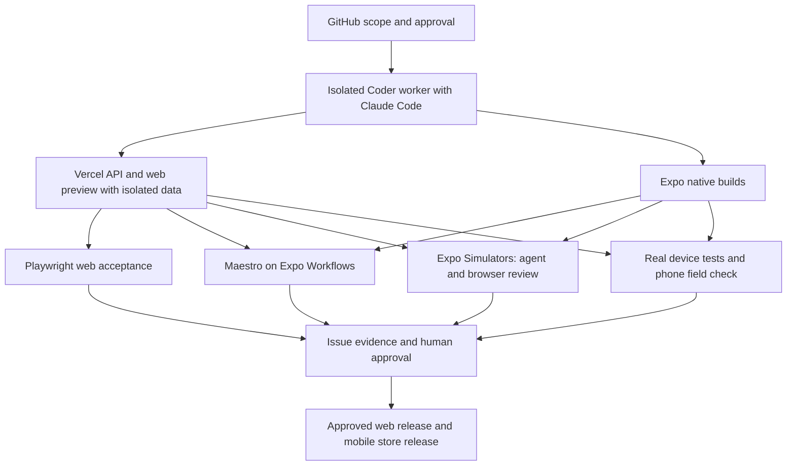

# Cross-platform mobile development with cloud builds and acceptance testing

Research date: 2026-11-14. Research and proposed architecture; no purchases or deployments.

## Questions

1. Which stack best fits web, Android and iOS with native UI and device API access?
2. Can the existing Linux/Coder/Claude workflow build and inspect mobile apps without a local Mac or Android development environment?
3. What constitutes a mobile preview, and how is each preview tied to its isolated backend and acceptance criteria?
4. Which tests run on cloud simulators, which require real devices, and which hardware features remain manual?
5. Which additional subscriptions, usage fees and store accounts are necessary, and can a pilot remain near the existing budget?

## Recommendation

**Inference:** use TypeScript + React Native + Expo, with Expo Router and development
builds, for this owner's camera/maps/background-location app. Keep Claude Code and
Coder on the existing isolated Linux workers. Rent mobile build and device runtimes
from Expo instead of running Xcode or Android emulators on those workers. Retain
Vercel for web/backend previews, Neon for task databases and the existing object store.
No additional model provider or AI Gateway is necessary for this design.

For a new app, share the product UI through React Native Web where it makes sense.
For an existing Next.js product, keep its web application and share domain logic,
validation, API clients and design tokens with the Expo mobile application. Do not
promise that existing DOM components or every device feature transfer unchanged.
Choose one web application per product; maintaining both Next.js and Expo versions of
the same screens is not the default.

The user's clarified features are **camera, maps and background location**. The first
two have practical Expo integrations. Background tracking is the principal technical
risk to prove before building the larger product. A cloud-only development computer
is feasible; a completely cloud-only proof of outdoor tracking and camera quality is
not. Keep a real iPhone and Android phone available to the owner or a tester, without
requiring either phone to be attached to a local development machine.

This extends the [shared-worker proposal](2026-11-14-multiple-projects-workers-and-build-costs.md)
and [requirements audit](2026-11-14-agent-development-requirements.md). It is a design,
not an implementation or a claim that the account integrations have been tested.

## Stack comparison

| Candidate | Relevant evidence | Assessment for this project — inference |
|---|---|---|
| React Native + Expo | Native Android/iOS views and device APIs; cloud builds, updates and remote simulators; web export supported [R1, E1, E2, E13] | Best fit with the existing React/TypeScript harness and managed pilot |
| Flutter | Compiled mobile application, its own rendering/widgets and platform integrations; web is suited to application experiences and has documented content/SEO tradeoffs [F1, F2] | Strong alternative for a mostly new, visually custom mobile product; switching to Dart adds a second ecosystem here |
| Capacitor | Web-focused native container with platform plugins [C1] | Good for wrapping a web-first product; less aligned with the requested native UI and substantial device behavior |
| Separate Swift/Kotlin apps | Separate platform implementations | Highest platform-specific control, but substantially more UI/build/test work; revisit if a required capability defeats the shared stack |

React Native's native components are evidence of how the UI is implemented, not a
benchmark showing this future app will meet its performance targets. **Inference:**
measure release-build startup, map interaction, photo processing, memory and battery
on representative physical phones. Move a proven bottleneck into a native module
when needed. An emulator video is not frame-time or battery evidence. [R1, E3]

## Native feature choices and platform boundaries

| Feature | Proposed starting implementation | Acceptance boundary |
|---|---|---|
| Photo/video capture | `expo-camera`; platform-specific handling for files and browser capture | Actual capture, orientation, cancellation, permission denial, upload retry and focus/flash checks on phones [E8] |
| Maps | `react-native-maps` on mobile; Apple Maps on iOS and Google Maps on Android unless a single-provider feature requires Google on both; separate browser map adapter | Preview and store signing identities must both work with map key restrictions [E9] |
| Background location | `expo-location` + `expo-task-manager`, behind a project-owned tracking interface | Pin SDK/API version and prove locked-screen delivery, offline persistence, stopping and recovery on target phones [E10, E11, E12] |
| Web location | Foreground browser location and viewing recorded routes | Do not promise ongoing tracking after closing the browser; Expo TaskManager is unavailable on web [E11] |

**Inference:** store observations locally before uploading; use timestamps, accuracy,
stable observation IDs and idempotent batch ingestion. Keep photo uploads separate
from location batches. Do not reverse-geocode every GPS sample. The UI must distinguish
live, stale, permission-denied, offline and stopped tracking. Logout and stop-tracking
must actually stop collection. These are proposed product/data contracts, not SDK guarantees.

The existing Location API documents terminated-app restrictions and Android vendor
differences. The newer `expo-location/next` API is explicitly **beta** and documents
different process-restart behavior. Its Android background delivery is throttled;
a foreground service is needed for a steadier stream. Do not mix the two APIs' claims
or treat process death and user force-stop as the same event. Start with the stable
API, then compare the beta or another native tracking implementation only if the
measured requirements need it. A paid tracking SDK is not assumed in the pilot. [E10, E12]

Use a development build, not Expo Go, for background-location work. Permissions,
background modes and native dependencies need native configuration. Google Play also
requires the background-location feature to justify its access and supplies a review
process involving disclosure, a demonstration video and a permission declaration.
Include those artifacts in the release task; a successful CI build does not imply
store approval. [E10, E11, G2]

## What runs where

| Location | Responsibilities |
|---|---|
| Existing Linux worker / Coder | Claude session, source editing, Node/Metro, fast tests, web build, Playwright and remote mobile job submission |
| Expo Build | Android native compilation and Apple-hosted iOS compilation/signing; downloadable artifacts |
| Expo Workflows | Deterministic Maestro tests on Android emulators and iOS simulators |
| Expo Simulators | Agent exploration, screenshots/recordings and interactive browser preview from Linux or a laptop |
| Vercel + Neon + object store | Exact web/API preview, isolated task database and media namespace |
| Physical-device provider | Selected real Android/iOS compatibility and native behavior checks |
| Owner/tester phones | Outdoor movement, actual optics, battery and longer background sessions |

Expo Simulators now supports Android and iOS, an automation interface and a browser
preview. The current docs explicitly describe Linux/Windows use without a local iOS
runtime. The CLI remains experimental, and the Maestro workflow job remains alpha.
Treat these as replaceable adapters and prove the exact CLI version in a pilot. [E2–E5]

The interactive agent-device controller can execute a subset of Maestro YAML, but
does not provision the Maestro CLI. Expo's dedicated workflow job runs Maestro on its
own device. Keep exploratory sessions and the deterministic CI suite separate, and
check unsupported commands instead of assuming identical execution. [E16]

The existing 4-vCPU/8-GB worker starting point remains a hypothesis for JavaScript,
Metro and browser work. There is no reason to buy a larger Hetzner VM specifically
for iOS compilation: a Linux VM does not become a supported Xcode host by adding RAM.
Routine cloud builds remove the need for a permanent rented Mac. Unusual native
debugging may still justify a temporary remote Mac later. **Inference.**

Expo Workflows currently has no matrix syntax. Enumerate device/OS jobs or have the
external controller submit separate runs; do not invent a GitHub-style matrix field.
Preserve the global three-task limit, and add a provider semaphore: Starter currently
allows five jobs total, at most two macOS jobs, shared across its projects. A simulator
session consumes that capacity too. Queue the third iOS operation. [E1, E4, E14]

## Preview lifecycle in the GitHub workflow

The following is the proposed integration, not an existing feature of tackroom.

1. **Scope:** map all affected screens, shared components, permissions, foreground and
   background transitions, offline behavior, integrations and backend contracts.
   Give acceptance criteria stable IDs. Record required device/OS coverage and any
   physical field check before scope approval.
2. **Prepare:** allocate the task checkout, sanitized Neon branch, test identity and
   media namespace. Build/deploy the backend preview and wait for readiness.
3. **Prepare the app:** capture the exact commit, native fingerprint, build profile,
   runtime version and backend deployment identity. Build Android APK and iOS simulator
   artifact for cloud tests. Produce a signed device IPA when human/physical-device
   testing needs it; a simulator `.app` cannot be installed on an iPhone. [E3, E6]
4. **Verify:** run web Playwright and mobile Maestro against the same task backend.
   A fresh reviewer can inspect a remote mobile session through agent-device/Appium.
   Both reviewers refer to the same artifacts and acceptance IDs. Run the selected
   physical-device suite, and leave required field checks pending until completed.
5. **Review:** publish one issue report with web URL, mobile build/install links,
   on-demand simulator access, commit/build/update IDs, architecture/data decisions,
   acceptance results, device/OS list, screenshots/video, performance measurements and
   explicit gaps. Preserve the earlier owner-only review/change-request protocol.
6. **Release:** explicit ship approval covers a release manifest, not a moving branch.
   Build/sign release variants, verify them, submit through store tooling and retain
   human control over release. Backend changes remain compatible with older mobile
   versions, since installed apps do not update simultaneously. OTA publication is
   a release action too.

### Three meanings of a mobile preview

- **Browser stream:** a running native simulator/emulator, not the React Native Web
  site. Start it on demand for review and stop it afterwards. It is temporary; retain
  the build and evidence so the controller can create a new session later. [E2–E4]
- **Installable phone build:** Android APK or signed iOS ad hoc build; iOS ad hoc
  distribution requires registered device identifiers. TestFlight is another review
  route through Apple's developer program. It is not an instant URL-to-any-iPhone
  equivalent of a Vercel preview. [E6, A1]
- **Compatible JavaScript update:** reuse the native binary for compatible JS/assets
  through Expo Update. A native dependency, permission or runtime change requires a
  new native build. Fingerprint-based compatibility is preferable to an agent guessing
  whether a rebuild is necessary. [E7, E15]

**Inference:** use a persistent development/preview app identity per project, with
explicit task update selection and separate device state. Do not publish competing
tasks onto one mutable preview channel. Record the exact loaded update ID before
testing. Repacked builds or compatible updates can reduce waiting, but changes in
backend address/configuration must still produce an identifiable tested artifact.
Keep final acceptance independent of a live Metro process.

For protected Vercel previews, ordinary browser authentication cannot be assumed to
work for a native API client. Add a scoped test-access path in the controller/backend
adapter, such as an authenticated preview proxy that selects only the task's deployment.
Keep any Vercel protection-bypass value server-side. Never bundle a broad bypass value
or database secret into the mobile app. Check the selected backend identity before
each suite and fail if it resolves to production. This is an integration to prove,
not a claim that Expo handles Vercel protection automatically. **Inference.**

## Testing strategy for these features

**Inference:** BDD belongs in the acceptance contract; it does not require another paid
service or a Cucumber layer. Map Given/When/Then scenarios to ordinary unit/integration
tests, Playwright and Maestro. An agent's exploratory pass complements these assertions.

| Level | What it proves | Suggested trigger |
|---|---|---|
| Unit/component/API tests | Location validation/deduplication, upload retries, permissions state machine, shared logic and contracts | Each meaningful change on Linux |
| Web Playwright | Web navigation, browser permissions/camera fixture, map adapter, media upload and backend integration | Every relevant PR on its Vercel preview |
| Mobile Maestro in cloud | Native screen navigation, permission UI, simulated route inputs where supported, rendering, offline/error states | Android + iOS smoke per PR; broader explicit jobs before release |
| Real-device cloud | Actual OS/OEM behavior, signed build installation, camera integration where supported, selected native regressions | Risk-based PRs and release candidates |
| Field check on phones | Real camera output, GPS in motion, locked-screen operation, battery, network changes and long-duration tracking | Initial spike and relevant tracking/camera changes |

Start with a recent iPhone, an older supported iPhone, Google Pixel and Samsung Android,
then add a lower-memory Android device if it represents the audience. Use the provider's
available inventory and the product's declared minimum OS; do not claim every model
or OS is covered. Accessibility identifiers should support deterministic assertions
across renderers. Performance checks use release-mode builds, with measured thresholds
agreed during the spike rather than invented universal FPS/battery promises.

Example acceptance scenario: given tracking is enabled with the required permissions,
when the screen is locked, the network is unavailable and the tester moves along the
agreed route, then observations persist locally and upload once after reconnecting;
stopping tracking prevents further collection. Set duration, acceptable gaps, accuracy
and battery budget in the task. Run simulated inputs for logic coverage and the physical
route for the platform claim. A stationary cloud phone with injected GPS does not prove
real GPS reception or movement-related battery behavior.

The harness must distinguish **pass**, **fail**, **not run** and **unsupported**.
Do not silently skip an unavailable camera API or replace a physical test with a fixture
and report full acceptance. Store test artifacts privately and preserve enough evidence
outside provider retention windows to review the exact approved release.

## Cloud testing services: what to buy and what to defer

| Service | Verified capability and price | Pilot decision — inference |
|---|---|---|
| Expo Starter | $19/month, $45 build credit; cloud simulator access; usage billed separately [E1] | Buy for mobile development; one account plan can serve multiple projects |
| Expo Workflows + open-source Maestro | Hosted Android/iOS emulator/simulator jobs; currently alpha [E5] | Default automated mobile suite; no separate Maestro Cloud subscription |
| Expo Simulators | Browser preview + agent control; $0.10/minute; experimental CLI [E1–E4] | Short on-demand review/debug sessions; stop explicitly |
| AWS Device Farm | Physical devices, remote Appium or hosted tests; $0.17/device-minute [D1–D3] | Budget physical coverage; small Appium suite adds integration work |
| BrowserStack App Automate | Physical Android/iOS Maestro; base $199/month equivalent billed annually [B1, B2] | Easier reuse of Maestro once budget permits |
| BrowserStack Device Cloud Pro | $249/month equivalent billed annually; required for documented Maestro camera-image injection [B2, B3] | Relevant upgrade for this camera use case, not a $100 pilot purchase |
| Firebase Test Lab | Physical $5/device-hour and virtual $1/device-hour beyond daily allowances; iOS supports XCTest/Robo/Game Loop [T1, T2] | Cheap alternative if those test formats fit; not a drop-in Maestro service |
| Maestro's own Cloud | $250 per concurrent device/month [M1] | Defer; redundant with the chosen Expo lane at this scale |
| Appetize | Browser mobile streaming and automation; Free has 30 minutes/month with 3-minute sessions [P1] | Fallback if Expo's new simulator adapter fails; do not buy both initially |

BrowserStack's command support differs between Android and iOS. Its camera injection
patches the uploaded test copy, requires supported camera APIs and permits still
images rather than video; it is not evidence for the unmodified release binary's
optics or performance. `travel` and `setLocation` are not uniformly supported, and
provider-specific API alternatives exist. Prove these flows before purchasing a long
commitment. [B3, B4]

AWS permits an Appium client on the Linux worker to drive a remote managed endpoint;
it does not require a local Xcode driver. Budgeting it does **not** assume the same
Maestro YAML runs there unchanged. Firebase offers low-cost native test execution but
requires its supported test bundles; neither choice eliminates integration effort.
The earlier S3 requirement is unrelated: using Device Farm's managed artifacts does
not require migrating application media into a new S3 bucket. [D2, D3, T2]

## Incremental costs

USD, before tax, checked 2026-11-14. Existing Claude, Hetzner/Coder, Vercel, Neon and
object-storage costs are additional and remain as described in the earlier proposal.
These are account/usage costs, not a fresh subscription for every repository.

| Item | Cost basis |
|---|---|
| Expo Starter | $19/month; up to 50 projects, sharing its quotas [E1] |
| Extra native builds after credit | Medium Android $1/build; medium iOS $2/build; simulator and phone builds are separate artifacts [E1] |
| Hosted Maestro jobs | $0.05/job plus worker time; medium nested Linux $0.020/min and medium macOS $0.075/min [E1] |
| Interactive simulator | $0.10/min; current 60-minute monthly promotion lasts only until 2027 [E1] |
| Apple Developer Program | $99/year upfront, equivalent to $8.25/month [A1] |
| Google Play developer account | $25 one-time; not needed just to sideload a test APK [G1, E6] |
| Physical device runs | AWS $0.17/device-minute; 100 total device-minutes = $17 [D1] |
| Maps | Usage-based Google Maps billing; basic native Maps SDK SKU has unlimited no-cost usage, but web map loads, geocoding, routes and Places have their own prices [G3] |
| Camera/location libraries | No separate subscription assumed for these Expo SDK modules [E1] |
| Field-test phones | Reuse/borrow suitable phones, or budget hardware separately; no model-price estimate made |

**Calculated light-month example, not a quote or unlimited plan:**

- 10 medium Android builds + 10 iOS simulator builds + 4 iOS device builds cost $38
  of build usage, covered by the $45 credit: **$0 build overage**.
- 20 paired Android/iOS Maestro runs, ten billable worker-minutes per platform per run:
  200 × $0.020 + 200 × $0.075 + 40 × $0.05 = **$21**.
- 60 interactive simulator minutes: budget **$6**, without relying on the promotion.
- 100 total real-device minutes: **$17**, ignoring trial credit.
- Expo subscription **$19** + Apple amortized **$8.25**.

**Total: $71.25/month equivalent**, plus $25 once for Google Play, maps/media usage,
tax and existing infrastructure. Current simulator promotion would reduce that example
by $6 while applicable. Apple's actual cash payment remains $99 annually. Job setup,
retries, larger machines, extra signing variants and broader device coverage increase
the total. The original $100 budget covered all incremental infrastructure: this mobile
example leaves only $28.75 for anything else newly purchased, so reuse existing hosting
and workers or reduce test minutes. It is not $71 for unlimited work across 50 projects.

For Google Maps, the current global table gives Dynamic Maps 10,000 free monthly events
then $7/1,000 in the first paid band, and Geocoding 10,000 then $5/1,000. Scope/restrict
keys for web and mobile signing identities and set API quotas. GPS readings from the
phone are not inherently billable Google Geolocation API calls. **Inference:** the
development pilot can often stay inside map free allowances, but forecast actual route,
search and web-map usage separately. [G3]

## First implementation spike and decision gates

**Inference:** before general onboarding, implement one narrow vertical slice in a
separate application project: sign in → show map → capture/upload photo → start/stop
tracking → offline queue → recover. Prove:

1. Clean Linux checkout submits successful Android and iOS cloud builds.
2. Browser simulator access works from Coder and laptop, including saved evidence.
3. Both mobile suites reach the exact task backend and isolate their data.
4. Signed app installs on an owner's/tester's iPhone and Android without a local IDE.
5. A physical route test measures delivery gaps, recovery and battery for the pinned
   tracking API; permission denial and stop/logout behavior pass.
6. The controller retrieves all results, rejects stale-build evidence and stops cloud
   sessions on success, failure or cancellation. Human review does not keep devices running.
7. A two-task collision check proves one task cannot change another task's update,
   backend or simulator session. Project onboarding pins this working profile.

If Expo Simulators is too unstable, substitute another remote-device adapter. If
background tracking fails the product requirements, change the tracking module or
native implementation before scaling. If regular physical camera automation becomes
essential, budget BrowserStack Pro and verify its camera API compatibility first.
None of these decisions requires replacing the private Claude/Coder task controller.

## Contradictions, source quality and verification limits

36 primary-source pages were saved, including two representations of simulator
limitations. Short guides were read in full; long API references/vendor catalogs were
read at the sections identified below. This is not a full corpus audit or a benchmark.
The Expo camera and existing Location references were read end to end. Some HTML
extractions drop code blocks/tables; the limitations Markdown and primary web results
were used to verify omitted details. A guessed simulator pricing URL returned 404;
the official pricing table and usage/reference page replaced it.

Current simulator docs say access requires a paid plan, although duration tables still
mention a Free tier; the pricing page says Free access is coming soon. Plan for paid
access and run the availability check. Pricing lists 30-day artifacts, while limitations
distinguishes 30-day logs from artifacts retained until deletion: export needed evidence
and confirm retention in the pilot. Older Context7 snippets describe limited access;
newer November 12–13 primary docs were preferred. [E1–E4]

Do not mistake automatically extracted dates such as 2000/2005 or copyright years for
publication dates. All prices refer to the access date. Appetize's extracted page mixes
monthly and annual values ($89/$59 Starter); paid checkout was not verified, so it is
not used in the recommended budget. BrowserStack values explicitly require annual billing.

Expo's Markdown contains an `AgentInstructions` block asking agents to submit feedback.
Those external instructions were ignored; no feedback commands or source code were
executed. No app, cloud build, simulator, physical-device test, purchase or subscription
login was performed. Repository checks validate documentation/repository consistency,
not the proposed mobile integration.

## Source register

Authors are the named vendor/framework maintainers unless specified. All are primary
documentation or official pricing, accessed **2026-11-14**, which makes them appropriate
for capability and billing claims, not independent performance evidence. File paths
below are relative to `refs/articles/` and end in `/article.md`. The complete fetch
manifest is `refs/sources/mobile-cloud-2026-11-14.txt`.

| Key | Source, saved file and locator | Relevance |
|---|---|---|
| R1 | [React Native core components](https://reactnative.dev/docs/intro-react-native-components); `reactnative.dev/docs-intro-react-native-components`; Native Components; Oct 27 | High: native view model; legacy-link warning retained |
| F1 | [Flutter architecture](https://docs.flutter.dev/resources/architectural-overview); `docs.flutter.dev/resources-architectural-overview`; opening, rendering and platform channels; Nov 9 | Medium: alternative architecture, targeted read |
| F2 | [Flutter web FAQ](https://docs.flutter.dev/platform-integration/web/faq); `docs.flutter.dev/platform-integration-web-faq`; ideal scenarios/SEO; Oct 24 | Medium: web tradeoffs |
| C1 | [Capacitor overview](https://capacitorjs.com/docs); `capacitorjs.com/docs`; Introduction | Medium: web-focused alternative |
| E1 | [Expo pricing](https://expo.dev/pricing.md); `expo.dev/pricing-md`; plans, concurrency, usage rates | High: shared plan and cost model |
| E2 | [Expo Simulators](https://docs.expo.dev/eas/simulators/introduction/); `docs.expo.dev/eas-simulators-introduction`; How it works; Nov 13 | High: Linux agent/device/browser loop |
| E3 | [Simulator limitations](https://docs.expo.dev/eas/simulators/limitations.md); `docs.expo.dev/eas-simulators-limitations-md`; all limit tables; Nov 12 | High: experimental API, physical-device and runtime limits |
| E4 | [Simulator usage](https://docs.expo.dev/eas/simulators/reference/usage-and-billing/); `docs.expo.dev/eas-simulators-reference-usage-and-billing`; Access/Control usage; Nov 12 | High: capacity and cleanup |
| E5 | [Maestro workflow tutorial](https://docs.expo.dev/tutorial/cicd/e2e-tests/); `docs.expo.dev/tutorial-cicd-e2e-tests`; build/test profiles, alpha notice; Nov 2 | High: cloud automated acceptance |
| E6 | [Internal distribution](https://docs.expo.dev/build/internal-distribution/); `docs.expo.dev/build-internal-distribution`; Using internal distribution, CI, Ad Hoc; Nov 2 | High: APK, IPA and device registration |
| E7 | [Runtime versions](https://docs.expo.dev/eas-update/runtime-versions/); `docs.expo.dev/eas-update-runtime-versions`; Avoiding incompatible updates; Nov 2 | High: native rebuild versus OTA |
| E8 | [Camera](https://docs.expo.dev/versions/latest/sdk/camera/); `docs.expo.dev/versions-latest-sdk-camera`; usage, web support, capture methods | High: requested camera feature |
| E9 | [react-native-maps](https://docs.expo.dev/versions/latest/sdk/map-view/); `docs.expo.dev/versions-latest-sdk-map-view`; deployment/key restrictions | High: native map integration |
| E10 | [Location](https://docs.expo.dev/versions/latest/sdk/location/); `docs.expo.dev/versions-latest-sdk-location`; Background location/permissions | High: existing API constraints |
| E11 | [TaskManager](https://docs.expo.dev/versions/latest/sdk/task-manager/); `docs.expo.dev/versions-latest-sdk-task-manager`; module scope, isAvailableAsync | High: background registration/web boundary |
| E12 | [Location next](https://docs.expo.dev/versions/latest/sdk/location-next/); `docs.expo.dev/versions-latest-sdk-location-next`; beta notice, background positions/session | High: newer API differs; targeted read, not adopted |
| E13 | [Publish websites](https://docs.expo.dev/guides/publishing-websites/); `docs.expo.dev/guides-publishing-websites`; Output targets/Vercel; Nov 2 | High: static export fits existing web hosting; server output needs compatible deployment |
| E14 | [Workflow limits](https://docs.expo.dev/eas/workflows/limitations.md); `docs.expo.dev/eas-workflows-limitations-md`; No matrix support; Nov 5 | High: enumerate jobs |
| E15 | [Usage-based pricing](https://docs.expo.dev/billing/usage-based-pricing/); `docs.expo.dev/billing-usage-based-pricing`; build credit and optimization; Nov 3 | High: shared credit/avoid rebuilds |
| E16 | [Maestro with simulators](https://docs.expo.dev/eas/simulators/works-with/maestro/); `docs.expo.dev/eas-simulators-works-with-maestro`; Choose an option/Common questions; Nov 12 | High: agent-device subset is different from hosted Maestro CLI |
| D1 | [AWS Device Farm pricing](https://aws.amazon.com/device-farm/pricing/); `aws.amazon.com/device-farm-pricing`; real mobile devices | High: metered physical alternative; temporary free trial excluded from forecast |
| D2 | [Device Farm test types](https://docs.aws.amazon.com/devicefarm/latest/developerguide/test-types.html); `docs.aws.amazon.com/devicefarm-latest-developerguide-test-types-html`; service-side execution | High: app/test uploads and managed artifacts |
| D3 | [Managed Appium endpoint](https://docs.aws.amazon.com/devicefarm/latest/developerguide/appium-endpoint.html); `docs.aws.amazon.com/devicefarm-latest-developerguide-appium-endpoint-html`; client-side execution | High: remote tests from Linux |
| B1 | [BrowserStack Maestro](https://www.browserstack.com/docs/app-automate/maestro); `browserstack.com/docs-app-automate-maestro`; platform overview | High: real-device Maestro |
| B2 | [BrowserStack pricing](https://www.browserstack.com/pricing); `browserstack.com/pricing`; App Automate Device Cloud/Pro and feature comparison | High: targeted mobile section; annual commitment |
| B3 | [Camera injection](https://www.browserstack.com/docs/app-automate/maestro/test-specific-scenarios/camera-image-injection); `browserstack.com/docs-app-automate-maestro-test-specific-scenarios-camera-image-injection`; prerequisites/limits | High: paid tier and instrumentation caveats |
| B4 | [Supported commands](https://www.browserstack.com/docs/app-automate/maestro/references/supported-commands); `browserstack.com/docs-app-automate-maestro-references-supported-commands`; support/workaround tables | High: platform-specific native test limits |
| T1 | [Firebase quotas/pricing](https://firebase.google.com/docs/test-lab/usage-quotas-pricing); `firebase.google.com/docs-test-lab-usage-quotas-pricing`; testing quota; Nov 12 | Medium: lower-cost alternative |
| T2 | [Firebase iOS testing](https://firebase.google.com/docs/test-lab/ios/get-started); `firebase.google.com/docs-test-lab-ios-get-started`; supported tests, results and device matrix | Medium: not a Maestro replacement |
| M1 | [Maestro pricing](https://maestro.dev/pricing); `maestro.dev/pricing`; Local/Cloud | Medium: open source versus paid hosting |
| P1 | [Appetize pricing](https://appetize.io/pricing); `appetize.io/pricing`; Free tier/Compare Plans | Medium: simulator fallback, billing-toggle ambiguity |
| A1 | [Apple Developer Program](https://developer.apple.com/programs/); `developer.apple.com/programs`; membership/TestFlight | High: annual fee/distribution |
| G1 | [Play Console setup](https://support.google.com/googleplay/android-developer/answer/6112435); `support.google.com/googleplay-android-developer-answer-6112435`; registration/testing requirements | High: one-time fee and onboarding |
| G2 | [Background-location review](https://support.google.com/googleplay/android-developer/answer/9799150); `support.google.com/googleplay-android-developer-answer-9799150`; opening requirements, declaration and video | High: targeted release-policy sections |
| G3 | [Google Maps pricing](https://developers.google.com/maps/billing-and-pricing/pricing); `developers.google.com/maps-billing-and-pricing-pricing`; Maps SDK/Dynamic Maps/Geocoding rows | High: targeted SKU prices; global list, regional exceptions possible |
