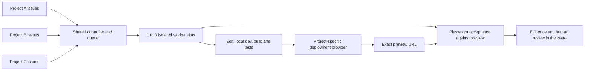

# Multiple projects: shared workers, hosting choices and build costs

Research date: 2026-11-14. Clarifies the
[Hetzner/Coder proposal](2026-11-13-hetzner-claude-subscription-development.md).
Research and design only; no infrastructure provisioned.

For Android/iOS projects, see the [mobile cloud-build and testing extension](2026-11-14-cross-platform-mobile-cloud-development.md):
native compilation and devices run in mobile cloud services, while the shared Linux
workers retain editing, orchestration and web checks.

## Questions

1. Which services are necessary when the owner uses one Claude subscription across projects?
2. Why use Vercel or Hetzner, and can either be removed?
3. What resources and monthly rental costs should the worker pool have?
4. How do builds/tests and onboarding stay easy across different repositories?

## Recommendation

**Inference:** operate one reusable development service across the owner's projects.
Start with a small trusted control host and one worker, reusing existing machines where
they meet the requirements. Add workers only when measured queue pressure justifies it.
Apply the three-task limit globally, with a default of one active task per repository.
The number of repositories does not determine the number of running machines.

Vercel remains an optional application deployment provider for projects that already
use it. Hetzner remains one option for development compute. Neither belongs in the
portable project harness as a compulsory dependency. Keep the controller in a separate
infrastructure project: tackroom remains a library copied into projects, without a
cross-project registry, synchronizer or drift tracker.

## What each service does

| Responsibility | Preferred pilot location | Other valid choice |
|---|---|---|
| Claude inference | Owner's Claude subscription | Keep the existing personal account and its shared allowance |
| Issues, approval and scheduling | GitHub plus trusted controller | Same controller logic can use a different execution provider |
| Coder, controller and control PostgreSQL | Small persistent Linux host | Any suitable existing server; Coder is optional if SSH is enough |
| Editing, dependency installation, dev server, build checks and Playwright | Linux worker | Vercel Sandbox or another isolated development environment |
| Application preview and production | Vercel for Vercel projects | The project's existing hosting, or a separately operated deployment host |
| Application dev/preview databases | Neon for Neon projects | A project-specific database lifecycle adapter |

Anthropic's current guidance says signed-in SDK/print-mode use draws from subscription
limits. A worker or repository does not receive a fresh allowance. Treat capacity as
one owner-wide pool, including laptop and reviewer use. No model GPU is needed on the
worker because inference runs at Anthropic. [A1; scheduling and GPU implications are inference]

Vercel's Pro platform fee is $20/month for one deploying seat, with shared usage credit.
It is not $20 for every repository imported into the same team. Usage still accumulates
across the team's projects. Its deployment system builds the app on Vercel; the ordinary
deployment build is not the persistent interactive computer used for development. [V1, V2]

An always-on VPS is useful for reliable webhook handling and worker availability while
the laptop is asleep. It does not have to be a newly purchased Hetzner VPS: an existing
server with sufficient spare resources can fill the role. A laptop-only worker is a
valid manual pilot, but autonomous work stops when that laptop is unavailable.

## Worker sizing

**Inference: starting budgets to benchmark, not measured requirements for these projects.**

| Role | vCPU | RAM | Local SSD | Operating rule |
|---|---:|---:|---:|---|
| Controller + Coder + control database | 2 | 4 GB | 40–80 GB plus checkpoint capacity | Do not run project builds on this host |
| Ordinary Next.js/React task worker | 4 | 8 GB | 80–160 GB | One heavy build at a time; start Playwright with 1–2 browser workers |
| Larger Next.js app or monorepo worker | 8 | 16 GB | 160 GB or more | Use when measured memory/build latency requires it |

Keep CPU/memory/disk limits per task and measure peak memory, disk growth and build
duration. Cache cleanup and artifact retention matter when many repositories pass
through a slot. A shared-vCPU plan can have variable build performance; it is not a
promise of dedicated CPU throughput. [H1, H2]

For three concurrent tasks with the earlier strong isolation requirement, use three
worker VMs plus the control host. They serve any of the projects. Several containers
on one larger machine are cheaper to administer but share a kernel; that is a different
isolation guarantee. Do not silently substitute it for the requested VM separation.
Keep application production off the build workers.

## Hetzner costs checked in the live browser

The public pages' extracted text omitted prices, so the rendered pricing tables were
read in the built-in browser on 2026-11-14. Display currency: EUR; prices include IPv4
and exclude VAT. These are advertised rates, not a confirmed order or existing-account
invoice. The pages displayed availability warnings, so availability needs checking in
the console before purchasing. We did not enter the console or change an account.

| Role/model | Advertised resources | Cost-Optimized monthly rate |
|---|---|---:|
| Controller: CX23 | 2 vCPU, 4 GB RAM, 40 GB NVMe | €5.99 |
| Standard worker: CX33 | 4 vCPU, 8 GB RAM, 80 GB NVMe | €8.99 |
| Larger worker: CX43 | 8 vCPU, 16 GB RAM, 160 GB NVMe | €16.49 |

Source: Hetzner's rendered [Cost-Optimized table][H1]. Its limited stock is material:
do not assume a new CX instance can always be ordered at these prices.

**Calculated rental totals:** control + one standard worker = **€14.98/month**;
control + one larger worker = **€22.48**; control + three standard workers = **€32.96**;
control + three larger workers = **€55.46**. Add backups, extra storage and tax. These
totals exclude Claude, application hosting, databases and artifact-store usage.

The Regular Performance table displayed Helsinki starting rates of **€16.99** for
CPX22 (2 vCPU/4 GB), **€30.49** for CPX32 (4 vCPU/8 GB) and **€59.49** for CPX42
(8 vCPU/16 GB). These give **€47.48** for control + one standard worker, and **€108.46**
for control + three standard workers, before extras. Other regions differ. [H2]

Consequently, the earlier $100 incremental budget is plausible when reusing capacity
or obtaining the cheaper pool, but not a promise for every all-new three-worker plan.
Allocated Hetzner servers remain billable while powered off. [H3]

## Could Vercel run the workers too?

Yes: **Vercel Sandbox** provides isolated execution that can install dependencies,
run builds, start a dev server and run browsers. It is separate from ordinary app
deployment hosting. Current persistent sandboxes preserve files across stop/resume;
processes must be restarted. Pro sessions currently last up to 24 hours, with later
sessions resuming saved state. This changes the runner lifecycle rather than eliminating
the controller, native Claude session storage or input bridge. [V3, V4]

No AI Gateway is required merely to rent a Sandbox. Using the owner's signed-in
official CLI there is a candidate configuration, not something this research has
verified. Login retention, interactive takeover and native session recovery need the
same spike as the VPS runner. Coder workspace management is unnecessary if the Sandbox
adapter supplies the required terminal access; preserving Coder itself would require
additional integration and hosting. [A1; integration choices are inference]

Current default-region (`iad1`) rates are $0.128 per active vCPU-hour and $0.0212 per
provisioned GB-hour. Idle waiting still incurs allocated-memory cost. For one 4-vCPU,
8-GB sandbox over **100 running hours**, memory costs $16.96; CPU costs $5.12 at 10%
average utilization or $51.20 at 100%. Thus the calculated execution range is
**$22.08–68.16**, excluding snapshots/other charges and before remaining Pro credit.
Three such workers running 100 hours each cost **$66.24–204.48** on those assumptions.
This is arithmetic, not a workload forecast. [V3]

**Inference:** persistent VPS workers suit frequent interactive use and fixed costs.
Sandbox suits intermittent isolated jobs and reduced server administration. Normal
Vercel deployment builds can remain on Vercel in either case. Moving all development
compute to Sandbox is possible, but does not fit the subscription/Coder preference as
directly as reusing the owner's existing machines.

## Make setup repeatable per project

The intended onboarding is one reviewed project configuration plus a standard bootstrap,
not installing the whole service again. This is a proposed contract, not a tool already
implemented in tackroom:

1. Copy the baseline harness into the repository using the existing setup workflow;
   retain project-local instructions/memory and pin its revision for each task.
2. Select a versioned worker image/dev-container profile with the project's language
   runtimes, package manager and Playwright dependencies. Bake stable tools once.
3. Declare commands for dependency preparation, dev startup/readiness, checks/build,
   test-data creation, acceptance tests and cleanup. A clean checkout must run these
   without an agent having to rediscover them.
4. Connect the repository/board, that project's data and deploy adapter, scoped access
   references and its acceptance/release policy in the external controller.
5. Run an onboarding proof: clean checkout → data setup → running app → build/checks →
   deployed preview → authenticated Playwright acceptance → archived evidence/cleanup.

Use version-keyed dependency caches and project-specific build caches. Do not copy one
repository's `node_modules`, login sessions or mutable memory into another. Each task
gets its own checkout, database identity, browser profile and session checkpoint.

For Vercel projects, the worker performs fast development checks and a production-build
check as appropriate, then Vercel performs the actual deployment build. The verifier
tests that exact preview. Agents never need a developer to manually start the server
for routine tasks once onboarding is proven. For other hosting, replace the deployment
adapter while retaining the task, session, testing and approval contract. This is our
recommended architecture, not an out-of-the-box product claim.

## Sources and validation limits

[A1]: https://support.claude.com/en/articles/15036540-use-the-claude-agent-sdk-with-your-claude-plan
[H1]: https://www.hetzner.com/cloud/cost-optimized/
[H2]: https://www.hetzner.com/cloud/regular-performance/
[H3]: https://docs.hetzner.com/cloud/billing/faq/
[V1]: https://vercel.com/docs/plans/pro-plan
[V2]: https://vercel.com/docs/builds/configure-a-build
[V3]: https://vercel.com/docs/sandbox/pricing
[V4]: https://vercel.com/docs/sandbox/concepts/persistent-sandboxes

All sources are primary product documentation or official vendor pricing, accessed
2026-11-14. Locators: A1 October 7 update; H1/H2 rendered model/region tables; H3 billing
while stopped; V1 platform fee; V2 build command; V3 metrics/Pro rates/resource limits;
V4 persistence and sessions. H1/H2 price observations above come from the rendered
browser, since static extraction drops them. The other previously saved sources are
reused; the new-page manifest is
`refs/sources/multiple-projects-workers-2026-11-14.txt`.

No server inventory, subscription login, live model, project build, browser acceptance
test or deployment was performed. Resource sizing and onboarding remain design choices
until tested on an actual project.
