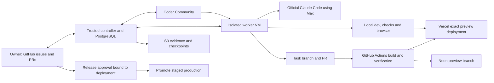

# Scinito: Claude Code development service setup

Date: 2026-11-14. Research and implementation runbook; nothing provisioned or changed in Scinito.

## Questions

1. Which existing Scinito services and workflows should we reuse?
2. What must be rented, installed, configured or built for GitHub-supervised development?
3. How do isolated data, native Claude sessions, preview verification and human release approval work?
4. What is the smallest useful pilot, and how does it grow to three concurrent tasks?

User-confirmed inventory: GitHub, Vercel Pro, Neon, S3 and Claude Max already available.
No Hetzner server currently available. Web/Next.js only; no mobile services required.

## Recommendation

**Inference / proposed design:** keep Scinito on Vercel, Neon and S3. Add Coder Community
and a small custom TypeScript development controller on a trusted Linux control server.
Run the owner's signed-in official Claude Code on a separate Linux worker VM. Reuse
Scinito's GitHub Actions build/deployment pipeline and tests; harden and connect them.
Start with one active task; later use three worker VMs and a global three-task ceiling.

This is not an installable product assembled by buying subscriptions. Coder supplies
workspaces and terminals. **The scheduler, GitHub conversation bridge, session ownership,
evidence reports and approval logic are software we still need to implement.** The guide
below separates existing capabilities, configuration work and that implementation.

No Scinito files, cloud settings or accounts were changed. Dashboard configuration,
available server stock and live deployment behavior have not been verified. Commands
below are instructions for the eventual operator; they were not executed against Scinito.

## Findings from the actual repository

Inspected local checkout: `/home/pedrum/Dev/scinito`, GitHub repository
`notionwave/scinito`. The separate `scinito-web` checkout is an older application and is
not the target of this guide. Local checkout state may differ from deployed branches.

| Existing item | Evidence and consequence |
|---|---|
| Next.js 16.2.9, React 19.2.7, Prisma 7.9.1, pnpm 10.24.0 | `package.json`; use Node 22 to match CI and the checked-in lockfile |
| Tackroom already adopted | `AGENTS.md`, `docs/decisions/0009-adopt-tackroom-harness.md`; retain project customizations instead of copying the template again |
| Development PRs target `edge` | `AGENTS.md`; branch pattern is `task/<issue>-<slug>` and the owner merges |
| Production is `main`; `edge` deploys Nightly | `.github/workflows/vercel.yml`; do not rename or collapse these branches |
| Builds currently run in GitHub Actions | `.github/actions/deploy-vercel/action.yml` runs `vercel build`, then uploads with `vercel deploy --prebuilt`; Vercel hosts the result |
| App deployment plus separate EKB production deployment | `vercel.yml`; release planning must account for both, even if the pilot automates only App previews |
| Preview Neon setup exists | Composite action creates/looks up `preview/<branch>`, migrates, seeds, and applies a seven-day expiry, currently after deployment |
| Existing seed is minimal | `scripts/seed/preview.ts` creates an organization and plans; it does not provision the full role/user/PDF/research-space acceptance dataset |
| Preview E2E exists but is not a gate | `e2e-preview.yml` is manual, uses `runs-on: default`, and has job-level `continue-on-error: true` |
| Playwright has a target override | `test/e2e/playwright.config.ts` reads `PLAYWRIGHT_BASE_URL`; smoke helper also supports `SC_SMOKE_BASE_URL` |
| Main check is only one layer | `scripts/agent/check` runs typecheck, lint and Jest, explicitly excluding integration tests and Playwright |
| Integration tests have real data services | `test/integration/README.md`, `integration-tests.yml`: Postgres, Redis and ClickHouse; external/model boundaries mocked |
| Authentication is Keycloak | Preview workflow and E2E runbook describe a nightly realm; cloning Neon does not clone Keycloak users or clients |
| Existing preview login was documented as working | `docs/runbooks/e2e-reliability-roadmap.md` records an April 2026 verification; this is historical evidence, not a fresh live check |

The current integration preparation package script contains `cd ../ pnpm ...`, which
does not correctly sequence changing directories and running pnpm. Its devops script
also calls legacy `docker-compose`. Fix this in an onboarding PR and verify the complete
integration bootstrap rather than advertising that command as ready for a fresh VM.

The smoke README and config disagree about the login-fixture arrangement. Use executable
behavior and a fresh run as evidence; do not treat README descriptions as proof of readiness.

## Modules and where they run



| Module | Runs on | What it does | Status |
|---|---|---|---|
| GitHub repository, Issues, Project board | GitHub | Tasks, discussion, approvals, PRs and checks | Existing service; board configuration needed |
| Coder Community | Control VM | Browser terminal/IDE, workspace access and lifecycle | Install/configure |
| Caddy HTTPS proxy | Control VM | TLS for Coder and webhook endpoint | Install/configure |
| PostgreSQL control store | Control VM, persistent volume | Coder database plus separate controller database/role | Install; never use a disposable application branch |
| Development controller | Control VM | Webhooks, durable queue, revisions, approvals, dispatch, recovery, reports | Build |
| Worker image and Coder Terraform template | Worker VM / trusted provisioner | Repeatable Node/pnpm/browser/tool installation, workspace disk, dev startup | Build/configure |
| Claude runner | Worker VM | Launch official CLI through SDK, preserve sessions, forward questions, enforce exclusive takeover | Build |
| Project harness | Scinito checkout | Scope, implementation, review, verification and project memory | Already present; targeted additions only |
| Data adapter | Trusted controller/CI | Create task databases and fixtures; issue narrow runtime access; clean up | Adapt existing Neon workflow |
| Deployment adapter | Existing Actions plus controller | Build once for target, identify exact deployment, await app/data readiness | Adapt existing workflow |
| Verifier | Clean CI job plus worker browser | Tests frozen criteria, fresh review, evidence capture | Existing tests; add task acceptance mapping |
| Artifact/checkpoint store | Existing S3 | Reports, traces, video, native session recovery packages | Configure separate private bucket or isolated prefix |
| Release adapter | Trusted controller/owner | Stage production, report evidence, promote only the approved release | Build/adapt; keep owner in control |

There is no requirement for Kubernetes, a managed Redis queue, Vercel AI Gateway, Coder
Agents paid orchestration, Codespaces or another coding subscription. Redis used by
Scinito's application tests remains; that is different from adding Redis for our queue.

## Subscriptions and monthly budget

Rates below are the same-day advertised rates recorded in the
[worker cost research](2026-11-14-multiple-projects-workers-and-build-costs.md#hetzner-costs-checked-in-the-live-browser).
Hetzner prices are EUR, include IPv4 in that table, and exclude VAT. Stock was limited.
They are not a confirmed purchase quote. Dollars and euros are deliberately not added.

| Service | Purchase decision | Incremental monthly budget |
|---|---|---:|
| Claude Max | Keep existing owner account | $0 new fixed subscription; all workers share its limits |
| Vercel Pro | Keep existing team/project | $0 new fixed subscription; additional platform usage can cost more |
| Neon | Keep existing account; dev/test branches with expiry | Usage-dependent; reserve $10–20 initially, not a vendor flat fee |
| S3 | Keep existing account; private agent artifacts | Usage-dependent; reserve $1–5 for a light pilot, not a quote |
| GitHub | Keep existing organization plan | $0 if sufficient; Team advertises $4/user/month if private repository protection is needed |
| Coder Community | Self-host | $0 software license |
| Control VM: CX23 | 2 vCPU, 4 GB RAM, 40 GB disk | €5.99 advertised |
| Worker VM: CX43 | 8 vCPU, 16 GB RAM, 160 GB disk | €16.49 advertised |
| Backups, extra disk, CI overage | Budget and monitor | Variable; add to totals before purchase |

**Recommended pilot server rental: €22.48/month**, before backups/tax. The 16 GB worker
is a sizing judgment for this comparatively large app, native dependencies, ClickHouse
and browser workload, not a benchmark result. No GPU is needed.

If those cost-optimized models are unavailable, the earlier Helsinki regular-performance
quote was CPX22 control €16.99 plus CPX32 4-vCPU/8-GB worker €30.49 = **€47.48**. Start
that fallback with one heavy process at a time and measure memory. A CPX42 16-GB worker
raises the pair to **€76.48** before extras, making the $100 incremental budget tight.
Do not silently substitute the expensive pair. Three CX43 workers plus CX23 control
would be **€55.46** server rental, subject to availability and actual usage budget.

GitHub Team does **not** supply required environment reviewers for a private repository;
the documented feature restriction matters. Use our controller's authorized human
approval plus protected release branches; do not buy Enterprise just for this pilot.
Check current organization billing before upgrading: Team pricing is per billable seat,
not a $4 flat organization fee. [G1, G2]

Anthropic currently documents signed-in SDK/`claude -p` use against subscription limits.
Use that mode; do not configure API-key fallback in the coding runner. [A1]
**Scinito's product AI calls, embeddings, OCR and other provider APIs are separate from
the coding assistant.** Existing product/provider accounts and their live-test usage
still need funding; Claude Max does not replace them.

## Step-by-step setup

### 1. Create the infrastructure home and record the actual identifiers

Create a separate private repository, proposed name `notionwave/agent-infra`. Put the
controller, runner, infrastructure configuration and project adapter there. This keeps
tackroom a copyable harness library rather than turning it into a project manager.

Record: Scinito repository ID, org Project ID/status field IDs, `edge` and `main`, App
and EKB Vercel project IDs/team ID, Neon development project/seed branch IDs, S3 region
and artifact bucket, and the GitHub user IDs allowed to approve scope and releases.
Obtain IDs from existing dashboards; do not invent them or paste secret values into issues.

Retain Scinito's existing `AGENTS.md`, `WORKFLOW.md`, skills, hooks and memory. Pin a
harness revision in each attempt. There is no need to rerun `tools/setup` over this app.
For a different project later, use tackroom's setup dry run and a separate reviewed adapter.

**Exit check:** the operator can name every target and distinguish App Preview, Nightly,
App Production and EKB Production without relying on a branch-name guess.

### 2. Rent the control VM; define the worker template before renting extra workers

Use Ubuntu 24.04 LTS x86-64, one control VM and one worker created through Coder's
Terraform template. Choose a region near the existing Neon/Vercel region where possible.
Use SSH keys, automatic security updates and a host firewall. Expose HTTPS for the
control endpoints; restrict administrative SSH. Keep PostgreSQL off the public network.

Create DNS names such as `coder.<your-domain>` and `agents.<your-domain>` pointing to
the control VM. These are placeholders; a domain already owned is enough. Workspaces
must reach Coder's configured HTTPS access URL. Do not put project builds, arbitrary
agent tools or a general-purpose Actions runner on the control host.

### 3. Install Coder Community, PostgreSQL and HTTPS

Follow Coder's [official Docker install][C1] using a stable release pinned to a specific
image digest. Adapt its Compose example to run Coder, PostgreSQL and Caddy; set
`CODER_ACCESS_URL` to the public HTTPS Coder address and `CODER_PG_CONNECTION_URL` to
the private Coder database. Use persistent volumes and restart policies. Create a
separate controller database and role on the same PostgreSQL server.

For this VM-template design, omit the example's host Docker-socket mount/group access;
Coder does not need to create project containers on the control machine. Keep database
ports private. Pin Terraform providers/modules and retain their state in the trusted
control environment. Install the control stack with `docker compose up -d` after
reviewing its configuration. Back up PostgreSQL and test restoring it.

Coder's newly documented **External workspaces** feature is labeled Premium Early
Access on the live documentation. Avoid making the free pilot depend on it. Use a normal
Terraform template with `coder_agent` and the Hetzner provider instead. [C2, C3]

**Exit check:** Coder works over HTTPS, survives a control-server reboot, and restores
its workspace records from backup. Initial Coder setup is completed before exposing it
for routine use.

### 4. Build one reusable worker image/template

This is an infrastructure deliverable, not a template already present in tackroom.
Use the standard Coder template mechanism with the `hcloud` Terraform provider to
create one independent VM per workspace. Coder documents this provider-based approach
for clouds including Hetzner. [C2]

Install these in the image/startup provisioning:

- Node 22, pnpm **10.24.0** to match Scinito, Git, GitHub CLI, Python 3 and `jq`.
- Official Claude Code, pinned after a successful compatibility test; record CLI/SDK versions.
- Docker Engine with Compose v2 **on the worker** for disposable test databases.
- Linux build packages for dependencies such as `canvas`; verify the frozen install
  rather than assuming an image intended only for browsers can build Scinito.
- Playwright browsers and OS libraries matching the resolved lockfile version.
- Coder agent, optional browser VS Code, and the custom runner once implemented.

Keep `/home/agent` and task workspaces persistent for the slot. Bake no account login,
product keys, SSH private keys or active session into a reusable image. Sign the owner
into Claude separately in each initial worker. Stop/start behavior must retain the
workspace disk; deleting a VM requires a completed checkpoint first.

Create the first workspace as `scinito-worker-1`. Hetzner API access belongs only to
the trusted provisioner. Workers receive task-scoped resources, not control-plane access.
Keep the VM warm in the pilot; powered-off Hetzner servers remain billable anyway.

**Exit check:** a fresh workspace installs dependencies, starts the application, and
can be accessed both through Coder's terminal and `coder ssh scinito-worker-1`.

### 5. Establish isolated Scinito data and service bindings

Use a dedicated Neon **development/test project** with a synthetic seed branch named
`agent-seed`; retain the existing production project. If a suitable isolated nonproduction
project already exists, reuse it. Do not branch raw production data as the default.

For each task, create `dev/issue-<id>-<attempt>` from that seed. For each verified candidate,
create or reset a distinct `preview/issue-<id>-<attempt>` branch. Store IDs, not only
names, in the controller. Ensure migrations use the migration connection and application
runtime uses the intended runtime role/connection. Protect production and seed IDs
from every reset/delete operation. Set expiry and extend it during a human review.

Extend `seed:preview` with deterministic test organizations, roles, representative research
spaces/documents and known PDF fixtures. Provision matching **nonproduction Keycloak**
users separately. A Neon branch alone cannot isolate these dependencies:

| Dependency | Pilot binding |
|---|---|
| PostgreSQL | Separate dev and preview Neon branches |
| Keycloak | Dedicated test realm/client and task-specific users; preserve the existing login architecture |
| S3 product uploads | Separate nonproduction bucket or task prefix and restricted role |
| Redis and ClickHouse | Local containers for integration tests; isolated test databases/key prefixes for deployed flows |
| Inngest/background jobs | Existing nonproduction environment with task-bound event/data identity, or deterministic adapter for bounded tests |
| Search/OCR/model/email providers | Existing test accounts or explicit mocks; bounded live tests where required |

Inventory each preview runtime dependency before enabling autonomous tasks that touch it.
A service without a safe preview binding blocks that category of task. Shared production
Redis/ClickHouse, email or background jobs do not become isolated merely because Neon is.
Do not buy replacements for working services just to run this harness.

For Keycloak, register the verified preview callback origins and a dedicated client.
Prefer exact task callbacks or a controlled project domain; do not expand a blanket
wildcard over every tenant's `*.vercel.app` hostname. The existing April login proof
does not remove the need to retest today's authentication and organization matching.

**Exit check:** two task environments can create/change a test document without seeing
or modifying each other's database, uploads, caches, background work or users.

### 6. Prove manual development on the worker first

Use a task-scoped GitHub checkout identity. The following are real existing commands;
run them only after loading the isolated development configuration:

```bash
git clone git@github.com:notionwave/scinito.git
cd scinito
git switch edge
pnpm install --frozen-lockfile
pnpm prebuild
pnpm db:migrate
pnpm seed:preview
pnpm dev
```

In another terminal, run `scripts/agent/check`. Run `pnpm build` after stopping the dev
server, or in a separate checkout/output directory: avoid competing Next builds over
the same `.next` tree. A development server being reachable is not a production build test.

Fix and verify integration provisioning from step 1's findings; then use
`pnpm test:integration:ci` with disposable Postgres/Redis/ClickHouse. The wrapper must
fail immediately if migrations fail and must not accidentally target the Neon dev app DB.
Preserve the existing third-party mocks in integration tests.

Launch `claude` in the task checkout and sign into the existing Claude Max account.
Browser authentication for the initial CLI sign-in is separate from using Claude web
as the task interface. Verify the CLI is using the subscription, with no API-key override.
Test a small read-only task, stop it, and resume it with an explicit recorded session ID.

**Exit check:** dev, full check, production build, integration tests, CLI login and resume
have all been exercised on this actual worker. Record peak memory and duration.

### 7. Make preview deployment deterministic

Modify the existing deployment action rather than adding another independent deployment
system. Keep GitHub Actions as the builder for this pilot. Keep local builds for fast
feedback when warranted; the authoritative deployment build is the Actions artifact.

For the preview path, change the ordering to:

1. Resolve the PR head SHA, task attempt and approved spec revision.
2. Create/reset the intended preview Neon branch from the synthetic seed.
3. Run migrations and seed; configure all corresponding preview service bindings.
4. Supply that branch's settings **before `vercel build`**, and ensure the deployment
   runtime receives the same branch identity. Changing only the migration shell's
   `DATABASE_URL` does not establish this binding.
5. Build and deploy the prebuilt output with explicit Git metadata.
6. Capture the deployment ID/URL, verify team/project/target/SHA through the Vercel API,
   and wait for both Vercel readiness and application/data readiness.
7. Publish a machine-readable deployment manifest for the verifier/controller.

Choose exactly one owner for Neon preview lifecycle: the adapted workflow/controller.
Disable or reconfigure any competing Vercel integration auto-branching so it cannot
silently inject a different database. Current comments claim the integration handles
this after upload, but this was not validated and cannot fix build-time database access.
Neon documents branch creation before migration/testing; Vercel documents that upload
metadata cannot rewrite values already embedded in a prebuilt artifact. [N1, V1]

Use the CLI's structured result if supported by the pinned version, or its documented
stdout contract; do not guess a deployment URL. Current docs distinguish JSON output
in noninteractive mode from plain URL output. Test the parser with the pinned CLI
59.17.0 already used by Scinito before upgrading it. [V1]

**Exit check:** the manifest contains `{repository, commitSha, taskAttempt, specRevision,
vercelProjectId, deploymentId, deploymentUrl, neonBranchId, seedRevision}`; the running
preview proves it is using the intended test dataset without exposing connection strings.

### 8. Turn preview E2E into a required acceptance check

Adapt `e2e-preview.yml` to run automatically after the successful preview pipeline,
including migrations/seed, using its manifest. A successful deploy event alone is not
enough with the current post-deploy data preparation. Checkout the manifest's exact SHA.
If using `workflow_run`, verify source repository/branch/run and treat its artifacts as
untrusted until matched; never run arbitrary fork artifacts with elevated access.

Remove `continue-on-error: true`. For a reproducible pilot use `ubuntu-latest`, or prove
what the existing `default` runner label resolves to and that it is available. Install
browsers matching the lockfile; retain the existing pinned Playwright container only
while its version matches. Configure required checks on the PR head, not on a different
default-branch or synthetic merge SHA.

After the runtime bindings and test-account values are injected securely, this existing
command targets the manifest's preview:

```bash
PLAYWRIGHT_BASE_URL="$PREVIEW_URL" \
  pnpm --filter @scinito/test-e2e run test-ci -- --grep='@setup|@smoke'
```

The separate researcher smoke pack runs with:

```bash
SC_SMOKE_BASE_URL="$PREVIEW_URL" \
  pnpm --filter @scinito/test-e2e exec playwright test --config=smoke/playwright.config.ts
```

The latter also needs its `SC_SMOKE_RESEARCHER_USERNAME` and
`SC_SMOKE_RESEARCHER_PASSWORD` test-account variables. Select a small verified smoke
subset plus affected regressions: the existing roadmap warns that the `@smoke` tag
currently covers too much to promise a fast run.

Add task-specific acceptance tests mapped to AC IDs. Given/When/Then wording in the issue
is sufficient; Cucumber is not necessary. Cover researcher/admin/organization boundaries,
empty/loading/error states and related consumers of shared components. Follow Scinito's
role/accessibility selectors and existing prohibition on `data-testid`.

For accepted task flows record successful screenshots and a short video as well as
failure traces. Existing failure-only recording does not provide a successful demo.
Keep Playwright auth state out of published artifacts. If Vercel Deployment Protection
is enabled, add its bypass only to the verified deployment origin; it does not replace
Keycloak login and must not be forwarded globally to external origins. [V3]

If model prompts/routing change, also run the relevant stored evals; a capped live eval
is a separately reported check using the product API accounts. No successful mocked
test is described as proof of live provider behavior.

**Exit check:** deliberately break an acceptance assertion and show the required check
fails; fix it and show evidence from the exact candidate deployment.

### 9. Configure the GitHub App and board

Create a GitHub App installed only on the intended repositories. Give it Issues and
Pull requests write, Contents write for task branches, Checks write, Actions read,
and Metadata read. Grant organization Projects read/write if it is responsible for the
board. Additional permissions, such as Actions write to dispatch an existing workflow,
are optional and must match the implementation. Keep installation keys on the controller;
workers receive short-lived, repository-scoped tokens without administration or release bypass.

Subscribe to issues, issue comments, pull requests, reviews and workflow results used
by the chosen adapter. Verify webhook signatures, persist delivery IDs, deduplicate,
enqueue and return promptly. Reconcile missed events by polling. A controller restart
must not lose a human reply or start a second copy of a task.

Configure board statuses:

`Inbox → Scoping → Needs input / Scope review → Ready → Implementing → Verifying → Human review → Release ready → Done`

Keep the existing label workflow consistent with this richer board. Only an authorized
human can approve a scope revision; moving a card to Ready is not by itself an approval
of unspecified or subsequently edited criteria. Board/status IDs belong in the adapter.

Protect `edge` and `main` against direct agent pushes and agent merges. Require relevant
checks and human review; keep workflows/release policy changes under explicit owner
review. Current deploy workflows execute branch-controlled code with service access:
separate privileged operations before enabling autonomous workflow edits. Store the
privileged orchestrator in `agent-infra`, pin its trusted revision, and isolate source
build execution from infrastructure/release tokens.

### 10. Implement the controller and runner

These modules do not exist yet. Suggested infrastructure repository layout:

```text
apps/controller/       webhook API, queue, approvals, reconciliation, report endpoints
apps/runner/           official Claude SDK/CLI lifecycle, input callbacks, checkpoints
packages/contracts/    versioned task/spec/attempt/deployment/evidence schemas
packages/adapters/     GitHub, Coder, Neon, Vercel and S3 adapters
projects/scinito.yaml  non-secret IDs, commands and project policy references
infra/control/        Compose, reverse proxy, database backup/restore
infra/worker/         image provisioning and Coder Terraform template
```

Use a PostgreSQL job queue with transactional claims, leases and fencing generations.
Tables should cover tasks, attempts, slots, events/outbox, pending interactions,
approvals, deployments, resources, checkpoints and artifacts. No distributed queue
subscription is needed at this scale. Set `globalImplementationLimit: 1` initially;
its maximum is three. Manual takeovers count as occupied slots.

The runner loads Scinito's approved Claude Code project configuration and the SDK's
Claude Code system-prompt preset; do not assume a bare SDK call imports the complete
interactive harness. Capture the native session ID and launch manifest. Use callbacks
for `AskUserQuestion`/tool permissions and MCP elicitation. Save each pending question
before posting it to GitHub; match replies by question ID and authorized actor. [A2]

Proposed user commands, **to implement rather than already supported**:

| Issue comment | Controller behavior |
|---|---|
| `/agent scope` | Allocate a slot and investigate the issue |
| `/agent approve-scope S3` | Freeze that scope revision and queue implementation |
| `/agent answer Q17 Use the existing researcher flow` | Deliver an answer to the matching pending question |
| `/agent allow P9` / `/agent deny P9` | Resolve that specific permission request |
| `/agent take-over` | Stop automated writer, checkpoint, grant native terminal ownership |
| `/agent resume` | After human CLI exits, checkpoint and return ownership to automation |
| `/agent review R4 changes: ...` | Requeue the report's attempt with human feedback |
| `/agent review R5 approve` | Approve only the report's current SHA/spec/deployment |
| `/agent ship RELEASE-12` | Promote the previously verified staged release after authorization |

Do not interpret general issue prose as permission to execute a shell command or ship.
For a long unanswered interaction, persist the pending state; prove recovery using the
documented SDK/session mechanism for the pinned version. A deferred tool result is not
task completion. If an arbitrary program asks an unsupported terminal question, move
to Needs input and offer Coder takeover rather than silently answering yes. [A2]

**Exit check:** test duplicate deliveries, restart during a question, unauthorized and
stale answers, subscription exhaustion, lost worker heartbeat and a late report from
an old attempt. Every case preserves one active owner and the correct board state.

### 11. Prove native session takeover and recovery

After `/agent take-over` has actually stopped the writer, use Coder's browser terminal
or, from the laptop:

```text
coder ssh scinito-worker-1
cd <recorded-task-checkout>
claude --resume <recorded-session-id>
```

Restore the pinned settings/tool launch arguments as well. This continues the actual
session on the VM; the laptop is the terminal. Keep CLI login persistent, and back up
native session files plus checkout state before freeing/resetting the slot. Do not use
`/export` as a resumable backup or rely on `--continue` to find SDK-created sessions. [A2]

Actually moving execution to the laptop is a second implementation milestone: transfer
native session files/sidecars, exact code and uncommitted work, and runtime/harness
manifest; authenticate locally and restore resource access. Test path compatibility and
enforce a single writer during return. It is not automatic Coder synchronization.

**Exit check:** begin in automation, answer a GitHub question, take over in native Claude,
make a change, return to automation, reboot the worker, and continue with history intact.

### 12. Make the specification and report reviewable

Before implementation, the scoping agent posts a versioned spec containing:

- Reproduction evidence or current behavior and desired outcome.
- Every affected route, role, user journey and product state; integration dependencies.
- Existing similar components/flows with code references and a reuse decision.
- Shared-component consumers and neighboring flows that need regression coverage.
- Data/model/API changes, migration/backfill implications, and feature-flag behavior.
- Numbered acceptance criteria, test mapping and explicitly unresolved decisions.
- A prototype/screenshot when interaction or layout needs a human decision.

For reproductions, give the scoping browser a designated production test account with
the minimum role required, separate from its preview browser state. Default to observation
and a test tenant; require an explicit task decision for any real-user mutation. Do not
give the ordinary worker production database or infrastructure administration access.
When reproduction needs destructive state or paid generation, reproduce on the isolated
preview first and record any remaining production-only uncertainty in the scope.

Human approval freezes the spec. A builder cannot weaken acceptance criteria to turn a
failed test green. A fresh reviewer compares the implementation and evidence to the
approved spec; in the pilot this is sequential and shares the owner's usage budget.

The final issue report contains report revision, SHA, spec revision, preview link,
architecture and data-model decisions, alternatives/tradeoffs, migration plan, tests
with actual outputs and AC mapping, screenshots/video, relevant performance measurements,
known limitations and release/rollback instructions. Performance uses the same baseline
scenario and environment; report unmeasured areas rather than inventing improvement.

On new commits, invalidate affected checks and prior approvals. Release the implementation
slot only after verification finishes and the complete session is checkpointed; then
the next queued task can start while the human reviews. Needs input can also park safely
after a durable checkpoint; an active human takeover continues to occupy its slot.

### 13. Configure S3 evidence and retention

Use a private agent-artifact bucket distinct from product uploads. Suggested prefixes:
`scinito/issues/<id>/attempts/<attempt>/staging/`, `reports/<revision>/`, and
`checkpoints/<sequence>/`. Keep public access blocked and use encryption/least-privilege
access. Give workers time-limited upload access only to their staging prefix. The
controller verifies checksums and copies finalized evidence to a location workers cannot
overwrite. Store object keys and checksums in PostgreSQL.

Expose a stable authenticated report endpoint that generates short-lived S3 download
links. Do not place permanent public videos, raw auth state or full account configuration
in issues. Suggested pilot policy: traces/video 14 days, reports 90 days, checkpoints
through review and for 14 days afterward; extend records required for incidents.
These retention values are design choices, not provider requirements.

### 14. Add the production release gate

Retain feature PR → `edge` → Nightly. The owner reviews a separate release from `edge`
to `main`; the feature agent never merges. Changes to App and EKB are listed separately.

Before enabling autonomous runs, change the production deploy invocation in the
trusted pipeline from immediate promotion to a staged production build:

```bash
vercel deploy --prebuilt --prod --skip-domain
```

Also disable automatic assignment of production domains in relevant Vercel projects
so a second Git-triggered deploy path cannot bypass the gate. Ensure exactly one system
owns production deployment. Production tokens never enter ordinary worker sessions.

Run a bounded smoke check against the staged production URL, using a designated test
tenant and production-safe operations. A staged production build has production
configuration and may access production services even before domain assignment.
Database migrations and background jobs need their own reviewed, compatible plan;
`--skip-domain` does not isolate them or undo a migration.

Post `RELEASE-12` with the exact deployment IDs, source SHA, schema version, smoke evidence
and App/EKB ordering. Only after an authorized ship approval does the trusted releaser run:

```text
vercel promote <approved-staged-production-deployment-id>
```

This avoids confusing a preview with the actual production artifact: promoting Preview
normally creates a production rebuild, while promoting staged Production does not. [V1, V2]
Use expand/contract schema changes; rollback application deployment and data recovery
are distinct procedures. Mark Done only after promotion and post-release checks succeed.

### 15. Run one complete rehearsal, then expand

Use one low-risk real Scinito issue. Prove the complete path:

`Issue → scope/prototype → owner approval → isolated worker → implementation/checks → fresh review → exact preview tests → report → owner feedback → corrected report → owner merge → staged release → ship approval`

Intentionally fail a test, revise the spec, restart a worker, submit a stale approval,
and queue four tasks. At limit one only one runs; at limit three the fourth waits.
Confirm a finished task releases its slot and a human takeover does not create a fourth
writer. Verify cleanup of closed and abandoned previews, not only merged PRs. Delete
resources by recorded IDs, extend active reviews before expiry, and retain recovery evidence.

After the one-worker loop is stable, create workers 2 and 3 from the same template and
raise the global limit. Keep warm caches keyed by lockfile/toolchain; preserve per-task
checkouts, browser profiles and data. Measure cold and warm startup times before promising
fast onboarding. Run dev/build/integration/browser phases sequentially when memory is tight.

Finally, enable an outcome-driven memory/dream pass. It proposes small harness improvements
in a reviewed PR, with the observed failure and evidence for the change. It cannot change
approval policy, permissions or release gates itself. Pin active attempts to their existing
harness revision; adopt approved improvements for subsequent work.

## Delivery order and acceptance

| Deliverable | What must exist before moving on |
|---|---|
| 1. Workspace and data | One worker runs the existing app/checks/build; isolated auth/data/uploads work |
| 2. Preview pipeline | Correct Neon branch before build; immutable deployment manifest; failing E2E blocks |
| 3. Controller and session bridge | GitHub scope approval, durable queue, questions, native takeover/recovery |
| 4. Review and release | Versioned issue report, authorized feedback, staged production and ship gate |
| 5. Reuse and learning | Three-slot test, cleanup/restore proof, portable adapter, reviewed memory improvements |

No honest one-line installer exists for deliverables 2–4 today. The first useful milestone
is manual Claude Code in Coder with working previews/tests; the full board-driven workflow
requires the explicitly listed code and policy changes. Configuration/API limits remain
subject to a live onboarding test. This guide does not claim those tests have passed.

## Sources and limits

Six additional vendor pages were fetched/reused and read in full for this runbook. Other
vendor pages were targeted current checks, plus the existing cited research below. Some
saved HTML extractions omit code blocks or product badges; Context7/current rendered text
were used to confirm those details. Generated January 1 dates in Coder metadata are not
treated as reliable publication dates. All vendor sources below accessed 2026-11-14.
The architecture, module boundaries, retention periods and delivery sequence are our
recommendation, not a vendor-supported turnkey recipe.

- **C1 — Coder, Install Coder via Docker**, living official installation documentation,
  `refs/articles/coder.com/docs-install-server-docker/article.md`, Requirements and External
  database. [URL][C1]. Full read; supports host requirements, Compose and database setup.
- **C2 — Coder, Creating templates**, living official documentation,
  `refs/articles/coder.com/docs-admin-templates-creating-templates/article.md`, From scratch.
  [URL][C2]. Full read; supports Terraform/Hetzner template mechanism.
- **C3 — Coder, External workspaces**, living official documentation,
  `refs/articles/coder.com/docs-admin-templates-managing-templates-external-workspaces/article.md`.
  [URL][C3]. Full read; live page badge identifies Premium Early Access, omitted by saved extraction.
- **V1 — Vercel, vercel deploy**, dated 2026-09-18 in extraction,
  `refs/articles/vercel.com/docs-cli-deploy/article.md`, stdout, Prebuilt, Git metadata and Skip Domain.
  [URL][V1]. Full read; authoritative CLI contract, to verify against pinned project version.
- **V2 — Vercel, vercel promote**, dated 2026-07-15,
  `refs/articles/vercel.com/docs-cli-promote/article.md`, Usage and Timeout. [URL][V2]. Full read;
  also checked [Promoting Deployments](https://vercel.com/docs/deployments/promoting-a-deployment).
- **N1 — Neon, The Neon GitHub integration**, dated 2026-08-04,
  `refs/articles/neon.com/docs-guides-neon-github-integration/article.md`, workflow and key scope.
  [URL][N1]. Full read; supports branch lifecycle and sensitive connection outputs.
- **A1 — Anthropic, Use the Claude Agent SDK with your Claude plan**, update 2026-10-07.
  [URL][A1]. Official support page checked directly; distinguishes subscription sign-in from API-key billing.
- **A2 — Existing session/input requirements audit**, [note](2026-11-14-agent-development-requirements.md),
  sections 1–2 and sources S1/S2/I1–I3. Prior primary-source research; native transcript
  persistence, CLI resumption and SDK callbacks still require a live compatibility spike.
- **G1 — GitHub pricing**, [URL][G1]. Current official page, Team $4/user/month and included Actions allowance.
- **G2 — GitHub, Managing environments**, [URL][G2]. Current official feature restrictions;
  private environment reviewers must not be confused with ordinary PR branch protection.
- **C4 — Coder pricing**, [official page](https://coder.com/pricing). Current plan comparison;
  use Community workspaces and our runner, without depending on premium features.
- **H1/H2 — Hetzner public rate tables**, [cost research](2026-11-14-multiple-projects-workers-and-build-costs.md),
  same-day rendered-page observations, resource sizes, stock and tax caveats.
- **V3 — Protected preview access**, [prior requirements audit](2026-11-14-agent-development-requirements.md),
  preview verification section; [Vercel automation bypass documentation][V3].
- **Local evidence**: files listed in the findings table, plus Scinito's smoke/helper configs,
  workspace manifest and devops package scripts. Read-only local inspection; no product
  source or private configuration was transmitted to web searches or documentation services.

An embedded access token was incidentally discovered in the legacy checkout's Git remote
URL. It is not reproduced here. Revoke it and replace that remote URL before reusing that
checkout. No account or remote setting was changed by this research.

[C1]: https://coder.com/docs/install/server/docker
[C2]: https://coder.com/docs/admin/templates/creating-templates
[C3]: https://coder.com/docs/admin/templates/managing-templates/external-workspaces
[V1]: https://vercel.com/docs/cli/deploy
[V2]: https://vercel.com/docs/cli/promote
[V3]: https://vercel.com/docs/deployment-protection/methods-to-bypass-deployment-protection/protection-bypass-automation
[N1]: https://neon.com/docs/guides/neon-github-integration
[A1]: https://support.claude.com/en/articles/15036540-use-the-claude-agent-sdk-with-your-claude-plan
[G1]: https://github.com/pricing
[G2]: https://docs.github.com/en/actions/how-tos/deploy/configure-and-manage-deployments/manage-environments
